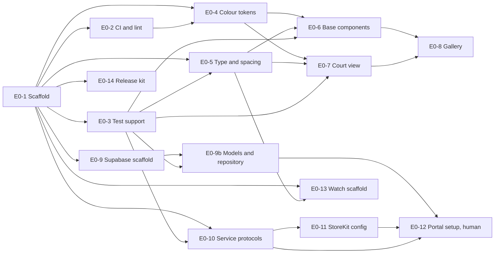

# Epic 0: Setup and design system

Mirrors the [Epic 0 doc](https://claude.ai/artifact/NQi2XJEWVDpNDoV2ZE5mgP) (rev 40). Each ticket is a GitHub issue labelled `epic-0`, with native blocked-by links.

## Epic goal

When Epic 0 is done, `aaronmusa/chair` builds and tests on a fresh clone and in CI, the `ChairKit` and `ChairUI` packages exist with their folder layout, every design token and base component renders in a gallery in light, dark and the largest accessibility size, the Supabase project has its first migration with RLS tests and a Claude proxy stub, the SwiftData offline cache and repository are wired, and auth, StoreKit and coach clients exist as protocols with test doubles. No feature screen or scoring rule is built.

**Definition of done**

- [ ] `make test` exits 0 on a fresh clone; GitHub Actions runs it on every PR and is green
- [ ] `ChairKit` builds for iOS 18, iPadOS 18 and watchOS 11; `ChairUI` builds for iOS, iPadOS and watchOS
- [ ] The design gallery shows every token and component in light, dark, AX5 text size and Reduce Motion
- [ ] A `Match` saved offline on one simulator reaches `chair-dev` and a second simulator on the same account after reconnecting
- [ ] App record, bundle id and sandbox subscription exist in App Store Connect; chair-dev and chair-prod Supabase projects exist with Apple auth enabled (human)

**Out of scope.** Scoring rules (Epic 1). Tab shell, new-match flow and any screen (Epic 2). Camera pipeline (Epic 4). Paywall UI (Epic 8).

**References.** [Chair — Epic roadmap](https://claude.ai/artifact/2fzCeoqNLuP8Dd29BPoXrB) for locked decisions. [Tennis AI Wireframes](https://claude.ai/artifact/JZ2gzgF491dKiy1h6tBfqN) for the visual language (monochrome ink on white, 1.5 px outlines, 10–12 px radii, system font). PicklGo Epic 0 for the package and CI shape.

## Repo and tooling tickets

### E0-1 Project scaffold (#2)

Create the Xcode project, two local packages and the Makefile.

- Xcode project `Chair.xcodeproj` with targets `Chair` (iOS + iPadOS, deployment 18.0), `ChairWatch` (watchOS 11.0, companion), `ChairTests`, `ChairUITests`.
- Local Swift packages under `ios/Packages/`: `ChairKit` (models, engine, services; platforms iOS 18, watchOS 11, macOS 15 so `swift test` runs on the Mac without a simulator) and `ChairUI` (tokens, components; iOS 18 and watchOS 11, so the watch app shares tokens and the court view). `ChairUI` depends on `ChairKit`. App targets depend on both. Anything iOS-only inside `ChairUI` (camera preview, `UIKit` bridges) is wrapped in `#if os(iOS)` — not `canImport(UIKit)`, which is true on watchOS; anything using `WatchConnectivity` in `ChairKit` is wrapped in `#if canImport(WatchConnectivity)` so the macOS build stays clean.
- Folder layout in the app target: `App/`, `Features/`, `Resources/`. In `ChairKit`: `Models/`, `Engine/`, `Services/`, `Persistence/`. In `ChairUI`: `Tokens/`, `Components/`, `Gallery/`.
- Swift 6 language mode, strict concurrency `complete`, plain `@Observable` MVVM the way Chorito does it (no BaseplateMacros; that package is Appetiser work code); one example `ExampleViewModel` in `Features/Example/` showing the pattern, deleted in Epic 2.
- `Makefile` targets: `make build`, `make test` (runs both package test suites and `ChairTests` on the newest iPhone simulator Xcode ships, resolved by name at run time, not hard-coded), `make lint`, `make gallery` (builds the gallery scheme). Xcode version is whatever is installed locally (26.5 as of writing); CI pins the same major via `xcode-select` and the `.xcode-version` file at the repo root.
- Bundle id `com.aaronmusa.chair`; display name `Chair`.

Acceptance:

- [ ] `make build` and `make test` exit 0 on a fresh clone with the Xcode named in .xcode-version
- [ ] Given the watch scheme, when it builds, then `ChairKit` compiles for watchOS with no `UIKit` import
- [ ] `ExampleViewModel` uses `@Observable` with no macros and has one passing unit test

### E0-2 CI and lint (#3)

GitHub Actions runs build, lint and tests on every PR; SwiftLint and SwiftFormat enforce house style.

- `.github/workflows/ci.yml`: macOS runner, Xcode version read from `.xcode-version` (must match local, 26.x), caches SwiftPM, runs `make lint` and `make test`, uploads the xcresult on failure.
- `.swiftlint.yml` with the PicklGo rule set plus a custom rule `no_raw_color` that flags `Color(red:` and `Color(hex:` outside `ios/Packages/ChairUI/Sources/ChairUI/Tokens/`.
- `.swiftformat` matching PicklGo.
- PR template `.github/pull_request_template.md` with sections What, Ticket, Screenshots, Checklist.
- Branch protection on `main`: PR required, CI must pass (human step noted in the ticket, not blocking).

Acceptance:

- [ ] A PR with a failing test shows a red check within 15 min
- [ ] Given a file in `Features/` containing `Color(red:`, when `make lint` runs, then it fails naming the rule `no_raw_color`
- [ ] `make lint` exits 0 on the scaffold

Blocked by: E0-1 (#2)

### E0-3 Test support package (#4)

Shared test helpers so every later epic can write Given/When/Then tests without boilerplate.

- `ChairTestSupport` target inside `ChairKit` (test-only): `InMemoryModelContainer()` for SwiftData, `FixedClock` conforming to a `Clock` protocol, `Fixtures` with `Match.sample`, `Player.sample`.
- Snapshot testing via `swift-snapshot-testing` for `ChairUI`; stored under `__Snapshots__` per test file; CI diffs them.
- `XCTestCase` extension `assertGivenWhenThen(_:)` is not required; plain `XCTest` with descriptive names.

Acceptance:

- [ ] Given `InMemoryModelContainer()`, when a `Match` is inserted and fetched, then the fetch returns it and nothing touches disk
- [ ] A snapshot test for one `ChairUI` component passes locally and in CI on the same simulator

Blocked by: E0-1 (#2)

## Design system tickets

The wireframes are monochrome; the brand palette is an open question. Tokens are built now with placeholder values so every later screen uses the API, and the values change in one place.

### E0-4 Colour tokens (#5)

Asset catalog with light and dark variants plus a Swift API.

- `Color.chair.ink` (text, outlines), `.inkSecondary`, `.surface`, `.surfaceRaised`, `.outline`, `.accent`, `.accentPressed`, `.court` (court-line colour on the mini court), `.playerA`, `.playerB`, `.success`, `.warning`, `.danger`.
- Placeholder values: light `ink #1A1A1A`, `inkSecondary #555555`, `surface #FFFFFF`, `surfaceRaised #F5F5F5`, `outline #DDDDDD`, `accent #1A1A1A`; dark inverts ink and surface. `[BRAND ACCENT]` replaces `accent` when the brand is chosen.
- A unit test asserting every text/surface pair used by `ChairUI` meets 4.5:1 (3:1 at 24 pt+) in both modes.

Acceptance:

- [ ] Given the gallery, when it opens in light and in dark, then every token shows a swatch for both modes
- [ ] `make test` runs the contrast test and it passes
- [ ] `make lint` finds no raw colour outside `Tokens/`

Blocked by: E0-1 (#2), E0-2 (#3)

### E0-5 Typography and spacing tokens (#6)

Type scale, spacing, radius and stroke constants, all Dynamic Type aware.

- `Font.chair.display` (28 pt bold), `.title` (22 pt bold), `.headline` (17 pt semibold), `.body` (15 pt), `.callout` (13 pt), `.caption` (11 pt semibold, uppercased, 0.04 em tracking), `.score` (34 pt bold, monospaced digits), `.scoreLarge` (56 pt bold, monospaced digits).
- `Spacing.chair`: 4, 8, 12, 16, 20, 24, 32. `Radius.chair`: `small` 8, `medium` 10, `large` 12, `card` 16. `Stroke.chair`: `thin` 1, `regular` 1.5, `bold` 2.
- All fonts scale with Dynamic Type via `relativeTo`.

Acceptance:

- [ ] Given AX5 text size, when the gallery renders every text style, then no text is clipped and `.score` still shows two digits on one line
- [ ] A snapshot per style in default and AX5 sizes passes

Blocked by: E0-1 (#2), E0-3 (#4)

### E0-6 Base components (#7)

The components every screen in the wireframes uses.

- `ChairButton` with styles `.primary` (filled ink), `.secondary` (1.5 px outline), `.ghost`; sizes `.regular` (48 pt) and `.large` (56 pt); loading and disabled states; min touch target 44 pt.
- `ChairCard` (outline 1.5 px, radius 12, optional raised surface).
- `ChairPill` for filter chips and badges (34 pt, selected = filled).
- `ChairSegmented` (two to four options, used for Singles/Doubles and input mode).
- `ChairRow` (list row with leading icon, title, trailing value, chevron).
- `ChairSheet` (bottom sheet container with 20 pt top radius used by the live screens).
- `CountdownRing` (circular progress ring with a number, 36 and 44 pt sizes) for the 5 s and 10 s timers.
- Every component has a `#Preview` in light, dark and AX5.

Acceptance:

- [ ] Given VoiceOver, when focusing each component, then it reads a label and a trait (button, selected, etc.)
- [ ] Given Reduce Motion, when `CountdownRing` runs, then it steps once per second with no animation
- [ ] Snapshot tests for every component in light, dark and AX5 pass

Blocked by: E0-3 (#4), E0-4 (#5), E0-5 (#6)

### E0-7 Court view (#8)

The reusable mini court used by live, get-set, summary and iPad screens.

- `CourtView` in `ChairUI`: draws a tennis court to scale (23.77 m x 10.97 m singles, 8.23 m singles lines inside, service boxes, centre mark) with `Stroke.chair.regular` lines, orientation `.portrait` or `.landscape`.
- Inputs: `players: [PlayerMarker]` (id, side, position in court metres, role `.server`/`.receiver`/`.partner`), `targetZones: [CourtZone]` (dashed rectangles), `ballMark: CourtPoint?` with `.in`/`.out` style.
- `CourtCoordinate` conversion from court metres to view points lives here; the homography (pixels to metres) is Epic 4 and must not be here.
- Sizes from 110 pt wide (mini) to full width; lines stay 1–2 pt at any size.

Acceptance:

- [ ] Given a server marker at (deuce side, 1 m behind baseline), when rendered portrait and landscape, then the marker sits in the correct quadrant in both
- [ ] Given a target zone, when rendered, then it draws dashed and does not cover markers
- [ ] Snapshot tests at 110 pt and 340 pt widths pass in light and dark

Blocked by: E0-3 (#4), E0-4 (#5), E0-5 (#6)

### E0-8 Design gallery (#9)

A debug screen listing every token and component with all states.

- `GalleryView` under `ChairUI/Gallery`, reachable from the app via a hidden gesture in debug builds only (`#if DEBUG`).
- Sections: Colours, Type, Spacing, Buttons, Cards, Pills, Rows, Sheet, Countdown ring, Court view.
- Toolbar toggles for light/dark, text size, Reduce Motion.

Acceptance:

- [ ] `make gallery` builds and launches the gallery scheme on the simulator
- [ ] Every component from E0-6 and E0-7 appears with every documented state

Blocked by: E0-6 (#7), E0-7 (#8)

## Data, services and platform tickets

### E0-9 Supabase project scaffold (#10)

The `supabase/` half of the monorepo with the first migration and local dev, same shape as Chorito.

- `supabase/` folder: `config.toml`, `migrations/`, `functions/`, `seed.sql`, `tests/` (pgTAP).
- Migration `<yyyyMMddHHmmss>_core.sql` (created with `supabase migration new core`, Chorito convention): `profiles` (id = auth user id, handle unique, display_name, avatar_url, home_court, hand, level, created_at), `matches` (id, owner_id, played_at, format, rules jsonb, status, input_mode, referee_mode, sets jsonb, created_at, updated_at), `match_players` (match_id, slot A1/A2/B1/B2, name, user_id nullable, link_status none/pending/accepted), `point_events` (id, match_id, index, at, winner_side, outcome, source, confidence, corrected, clip_path), `saved_courts` (id, owner_id, name, corners jsonb, placement), `training_sessions` (stub).
- RLS on every table: owner reads and writes own rows; a user with an accepted `match_players.user_id` link reads that match and its points; nobody else. Policies written as named SQL and tested with pgTAP.
- `supabase/functions/coach/` Edge Function stub returning a fixed card; reads `ANTHROPIC_API_KEY` from function secrets; verifies the caller's Supabase JWT. The real prompt is Epic 9.
- Makefile targets: `make db-reset` (`supabase db reset`), `make test-db` (pgTAP), `make functions-serve`.
- Generated Swift types via `supabase gen types swift` into `ChairKit/Persistence/Generated/`.

Acceptance:

- [ ] `make db-reset` applies all migrations on a fresh local stack and exits 0
- [ ] Given user A owns a match and user B is not linked, when B selects from `matches`, then zero rows are returned (pgTAP)
- [ ] Given user B has an accepted link on A's match, when B selects, then that one match and its `point_events` are returned (pgTAP)
- [ ] `make functions-serve` answers `POST /coach` with the fixed card for a valid JWT and 401 without one

Blocked by: E0-1 (#2)

### E0-9b Core models and offline-first repository (#11)

SwiftData cache plus the repository layer every feature writes through.

- `@Model` types in `ChairKit/Persistence` mirroring the Supabase tables: `Match`, `MatchPlayer`, `PointEvent`, `SavedCourt`, `TrainingSession`, plus `Profile`; each carries `remoteID`, `updatedAt` and `syncState` (`.synced`, `.pendingUpload`, `.pendingDelete`).
- `MatchRules` as a `Codable` struct: `sets` (bestOf3/bestOf5), `deuce` (advantage/noAd), `finalSet` (tiebreak7/tiebreak10/advantage), `firstServer`. `PointOutcome` enum: `ace`, `doubleFault`, `winner`, `unforcedError`, `forcedError`, `let`.
- `MatchRepository` protocol: `save`, `fetch`, `observe`, `delete`; `LocalMatchRepository` (SwiftData only) and `SyncingMatchRepository` (SwiftData + `supabase-swift` client with an upload queue, last-write-wins by `updatedAt`).
- Clips are files in Application Support referenced by path; never uploaded by this layer (Epic 6 owns opt-in upload).
- `ChairContainer.make(inMemory:)` factory.

Acceptance:

- [ ] Given a `Match` with two `MatchPlayer`s and three `PointEvent`s, when saved and refetched in memory, then relationships and order survive
- [ ] Given the device offline, when a match is saved, then it is `.pendingUpload` and `fetch` returns it; when the network returns, then it uploads once and becomes `.synced`
- [ ] Given the same match edited on two devices, when both sync, then the later `updatedAt` wins and no duplicate row exists

Blocked by: E0-1 (#2), E0-3 (#4), E0-9 (#10)

### E0-10 Service protocols and test doubles (#12)

Protocol seams for everything Chair talks to, so features build against doubles.

- `ChairKit/Services`: `AuthService` (Sign in with Apple via Supabase Auth, session, sign out, delete account), `SpeechOutput` (speak, stop, route), `SpeechInput` (start listening with a grammar, events), `CoachService` (`summarize(match:) async throws -> CoachCard`), `SubscriptionService` (entitlement, products, purchase, restore, trial state), `ClockProvider`, `Haptics`.
- Each has a `Fake*` in `ChairTestSupport` that records calls and returns fixtures.
- `CoachService` concrete `EdgeCoachService` calls the `coach` Edge Function with the user's JWT; no Anthropic key ever ships in the app. Supabase URL and anon key read from `Secrets.xcconfig` (gitignored) with a template `Secrets.example.xcconfig`.
- `SubscriptionService` concrete `StoreKitSubscriptionService` is a stub that reads `Products.storekit`.
- An `AppEnvironment` struct holds all services and is injected via `@Environment`.

Acceptance:

- [ ] Given the app launched in debug with `-UseFakes`, when it starts, then every service in `AppEnvironment` is a fake
- [ ] `EdgeCoachService` with no session throws `CoachError.notSignedIn` instead of crashing; `FakeAuthService` can be set signed in or out
- [ ] Unit tests for every fake compile and pass

Blocked by: E0-1 (#2), E0-3 (#4)

### E0-11 StoreKit configuration (#13)

Local StoreKit products and the subscription group, ready for Epic 8.

- `Products.storekit` with subscription group `Chair Pro`: `chair.pro.monthly` and `chair.pro.yearly`, each with a 7-day free trial introductory offer. Prices `[PRICE MONTHLY]` and `[PRICE YEARLY]` as placeholders.
- `Entitlement` enum in `ChairKit`: `.free`, `.trial(expires:)`, `.pro(expires:)`.
- Free cap constant `FreeTier.maxMatches = 20`.
- A StoreKit test (`StoreKitTest` framework) that purchases the monthly product and asserts `.trial` entitlement.

Acceptance:

- [ ] Given the StoreKit configuration selected in the scheme, when the test purchases `chair.pro.monthly`, then `entitlement == .trial` with an expiry 7 days out
- [ ] `FreeTier.maxMatches` is referenced from one place only

Blocked by: E0-10 (#12)

### E0-12 App Store Connect and Supabase setup (human) (#14)

Portal work that code cannot do.

- Create the app record `Chair` with bundle id `com.aaronmusa.chair` and the watch companion bundle id.
- Enable capabilities: Sign in with Apple, In-App Purchase, Background Modes (audio). Create Supabase projects `chair-dev` and `chair-prod`, enable the Apple provider in Auth with the Services ID and key, set `ANTHROPIC_API_KEY` as a function secret, link the local CLI to `chair-dev`.
- Create subscription group `Chair Pro` with the two products and the 7-day trial in sandbox.
- Add a sandbox tester account.
- Push the E0-9 migrations to chair-dev with supabase db push and deploy the coach function.

Acceptance:

- [ ] Sign in with Apple on a device creates a row in profiles on chair-dev; the E0-9b sync check passes on two devices with the same account
- [ ] A sandbox purchase of `chair.pro.monthly` succeeds on a device

Blocked by: E0-9 (#10), E0-9b (#11), E0-10 (#12), E0-11 (#13)

### E0-13 Watch companion scaffold (#15)

The watchOS target boots and shares models with the phone.

- `ChairWatch` app with one `ContentView` showing "Chair" and a placeholder score `0–0` using `Font.chair.score` from `ChairUI` (which builds for watchOS per E0-1).
- `WatchConnectivity` session wrapper `WatchLink` in `ChairKit`, the whole file inside `#if canImport(WatchConnectivity)` so the macOS `swift test` build from E0-14 compiles, with `send(_:)` and an `AsyncStream` of received messages; message payload is a `Codable` `WatchMessage` enum with one case `.ping`.
- Phone side: `WatchLink` activates on launch and replies `.pong` to `.ping`.

Acceptance:

- [ ] Given the paired simulators, when the watch sends `.ping`, then the phone replies `.pong` within 2 s
- [ ] `ChairKit` compiles for watchOS with no `AVFoundation` or `Vision` import

Blocked by: E0-1 (#2), E0-5 (#6)

## Release tickets

### E0-14 Install ios-release-kit (#16)

Release tooling from `aaronmusa/ios-release-kit`, set up the way Chorito has it, in Chair's look.

- Copy `bump-build.sh`, `capture-shots.sh`, `make-store-shots.swift` and `check-listing.swift` into `ios/Scripts/`. Start from Chorito's versions (`bump-build --tag-only`, `check-listing` forbidden words, store-shots overlay), not the kit's, and upstream anything new to `ios-release-kit`.
- `Makefile` gains `hooks`, `bump`, `testflight` and `check-listing`, wired to these scripts. `bump` raises `CURRENT_PROJECT_VERSION` in the iOS and watch targets together.
- `hooks/pre-push` runs `swift test` on `ChairKit` only, with warnings as errors (fast, no simulator); installed with `make hooks`. `ChairKit`'s `Package.swift` declares `.macOS` beside iOS and watchOS so `swift test` runs on the Mac.
- `docs/RELEASE_CHECKLIST.md` and `docs/APP_STORE_LISTING.md` filled in for Chair. The listing's App Review notes say how a reviewer reaches the paywall (the free cap is 20 matches, so the notes point to a review account already at the cap) and the 7-day trial; Pro IAP descriptions stay under 55 characters.
- `docs/store-shots.json` in Chair's look: ink on white, system font in place of Archivo, no brand accent until one is chosen. Covers the 6.9" iPhone, 13" iPad and Apple Watch sizes; landscape court captures are rotated with `sips -r 270`. If `make-store-shots` has no iPad or watch body, add one and upstream it.
- `ITSAppUsesNonExemptEncryption` = NO in the app's Info.plist.
- `aaronmusa/chair-legal` on GitHub Pages: landing, privacy and support pages styled like the gallery (ink #1A1A1A on white, inverted in dark mode, system font, 1.5 px outlines, 12 px radii), not Chorito's palette. Rewrite the privacy policy rather than fill it in: the kit's template assumes no accounts, server or SDKs, but Chair has Sign in with Apple, Supabase (profiles, matches, linked opponents), camera and microphone processed on device, opt-in upload of correction clips, match stats sent to Claude through the Edge Function, and StoreKit. The App Privacy answers change with it.

Acceptance:

- [ ] A failing `ChairKit` test blocks `git push`; the hook is never bypassed with `--no-verify`
- [ ] `make check-listing` passes on `docs/APP_STORE_LISTING.md` and fails when a field is over its limit
- [ ] `make bump` raises the build number in every target, and `make testflight` refuses to run anywhere but an up-to-date `main`
- [ ] `make-store-shots` renders one placeholder shot per device size from `docs/store-shots.json` in Chair's palette
- [ ] `chair-legal` serves landing, privacy and support pages in light and dark; the privacy policy names every data flow above

Blocked by: E0-1 (#2)

## Ticket order

After E0-1, the tooling (E0-2, E0-3), tokens (E0-4, E0-5) and services (E0-10) run in parallel; components, models and the watch scaffold follow their inputs.

Start with E0-1. Epic 1 (scoring engine) only needs E0-1 and E0-3, so it can begin while the design tickets are still open; Epic 2 waits on E0-8 and E0-9b; Epic 2a waits on E0-9, E0-10 and E0-12.
