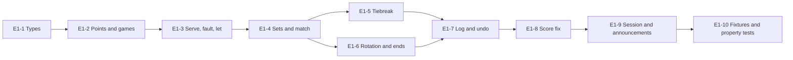

# Epic 1: Scoring engine and rules

Mirrors the [Epic 1 doc](https://claude.ai/artifact/UFFjDhDrWf5LEMb1S2PxC8) (rev 8). Each ticket is a GitHub issue labelled `epic-1`, with native blocked-by links.

## Epic goal

When Epic 1 is done, `ChairKit` holds a pure Swift tennis engine that turns a log of events into a full match state: points, games, deuce/advantage and no-ad, sets, 7-point and 10-point tiebreaks, best of 3 or 5, server and side rotation, doubles receiver order, lets, faults, undo and score-fix. Replaying the log reproduces the state exactly. The engine emits announcement events for Epic 3 and knows nothing about UI, camera, voice or persistence.

**Definition of done**

- [ ] Every rule in this doc has a Given/When/Then test; `ScoringEngine` line coverage is 100 % as reported by `make coverage` (added in E1-10)
- [ ] `MatchState(replaying: events)` equals the state reached by applying the same events one at a time, checked by a property test over 1,000 random event logs
- [ ] A full best-of-3 singles match and a full best-of-3 doubles match with a 10-point final-set tiebreak are scored end to end in fixtures and match ITF rotation
- [ ] `swift test` on `ChairKit` runs the whole suite on macOS in under 10 s

**Out of scope.** Any screen (Epic 2). Speech strings and audio (Epic 3, which maps `Announcement` cases to text). Camera events (Epic 6 produces `PointEvent`s; the engine only consumes them). Persistence (Epic 0's `PointEvent` model is the stored form; this epic defines the in-memory event and a mapping both ways).

**References.** [Chair — Epic roadmap](https://claude.ai/artifact/2fzCeoqNLuP8Dd29BPoXrB) Epic 1 and the locked decisions. [Chair — Epic 0](https://claude.ai/artifact/NQi2XJEWVDpNDoV2ZE5mgP) E0-9b for `MatchRules`, `PointOutcome` and the stored `PointEvent`. ITF Rules of Tennis 2024 for scoring, tiebreak and rotation rules. Wireframe screens 5 (get set) and 6 (live rally) for what the state must expose.

## Core engine tickets

### E1-1 Event and state types (#38)

The vocabulary every other ticket builds on. Pure value types in `ChairKit/Engine`, no logic yet.

- Reuse `Side` (`.a`, `.b`) and `PlayerSlot` (`.a1`, `.a2`, `.b1`, `.b2`; singles uses `.a1` and `.b1`) from E0-9b's `ChairKit/Models`; no new definitions, name stays `PlayerSlot`. This epic owns two new enums in `ChairKit/Engine`: `CourtSide` (`.deuce`, `.ad`) and `CourtEnd` (`.near`, `.far`). The same PR migrates `ChairUI`'s court view off its own types: E0-7's `CourtSide` (near/far) becomes `CourtEnd`, E0-7's `ServiceCourt` (deuce/ad) becomes `CourtSide`, and both ChairUI definitions are deleted. Snapshot tests for `CourtView` must pass unchanged.
- `MatchEvent` enum, `Codable`, `Equatable`, `Sendable`: `.pointWon(by: Side, outcome: PointOutcome?, ending: PointEnding?)`, `.fault`, `.let`, `.undo`, `.setScore(ScoreSnapshot)` (score-fix), `.swapServer`, `.swapEnds`, `.retire(Side)`. Every case carries `at: Date` and `source: EventSource` via a wrapping `TimedEvent` struct. `PointEnding` enum: `.out`, `.net` — how the rally ended, separate from `PointOutcome`'s stats category (an out is still a forced or unforced error), so the umpire can call "Out" or "Net" without widening `PointOutcome`.
- `EventSource` enum: `.manual`, `.camera(confidence: Double)`, `.shout`, `.gesture`, `.referee`, `.watch`.
- `GameScore` enum: `.love`, `.fifteen`, `.thirty`, `.forty`, `.advantage`; `TiebreakScore` as `Int`.
- `MatchState` struct: `rules: MatchRules`, `sets: [SetScore]` (completed), `currentSet: SetScore`, `currentGame: GameState` (`.standard(a: GameScore, b: GameScore)` or `.tiebreak(a: Int, b: Int, target: Int)`), `server: PlayerSlot`, `receiver: PlayerSlot`, `serverCourtSide: CourtSide`, `ends: [Side: CourtEnd]`, `faultCount: Int` (0 or 1), `phase: MatchPhase` (`.notStarted`, `.inProgress`, `.complete(winner: Side)`), `doublesOrder: DoublesOrder?`.
- `ScoreSnapshot` struct: the user-editable subset (sets, games, points, server) used by score-fix and by the watch mirror.
- `MatchRules` and `PointOutcome` are reused from E0-9b, not redefined. `MatchRules.firstServer` is the single source of the first server; the engine never takes a separate first-server parameter.

Acceptance:

- [ ] Every type is `Codable` and round-trips through JSON in a test
- [ ] `MatchState.initial(rules:)` returns `.notStarted`, love–all, 0 sets, server = `rules.firstServer`, deuce side
- [ ] `swift test` passes on macOS with no Foundation-only APIs beyond `Date`

Blocked by: E0-1 (#2), E0-3 (#4)

### E1-2 Point and game scoring (#39)

`ScoringEngine.apply(_:to:)` for `.pointWon` inside a standard game, with advantage and no-ad rules.

- `ScoringEngine` is an enum with static pure functions: `apply(_ event: MatchEvent, to state: MatchState) throws -> (MatchState, [Announcement])`. No stored state.
- Advantage scoring: love → 15 → 30 → 40 → game; 40–40 = deuce; from deuce a point gives advantage; advantage + point = game; advantage lost = deuce.
- No-ad (`rules.deuce == .noAd`): at 40–40 the next point wins the game; the receiver chooses the side, so the engine emits `Announcement.receiverChoosesSide` and the next `.pointWon` is accepted from either side without a side-choice event (choice is a UI concern, Epic 2).
- A game won increments `currentSet` games for the winner, resets points, and flips `faultCount` to 0.
- `.pointWon` on a `.complete` match throws `EngineError.matchOver`; on `.notStarted` it starts the match (phase → `.inProgress`).
- `Announcement` enum (defined here, text in Epic 3): `.score(a: GameScore, b: GameScore, serverSide: Side)`, `.deuce`, `.advantage(Side)`, `.game(Side)`, plus cases added by later tickets.

Acceptance:

- [ ] Given love–all, when A wins 4 points, then A has a game and the score announces "15–love, 30–love, 40–love, game"
- [ ] Given 40–40 with advantage rules, when A wins then B wins, then the state is deuce again
- [ ] Given 40–40 with no-ad rules, when B wins the point, then B has the game
- [ ] Given a complete match, when any `.pointWon` arrives, then `EngineError.matchOver` is thrown and the state is unchanged
- [ ] Announcements are emitted in server-first order ("15–love" when the server leads, "love–15" when the receiver leads)

Blocked by: E1-1 (#38)

### E1-3 Serve, fault and let (#40)

First and second serve state, double faults, lets.

- `.fault`: `faultCount` 0 → 1, emits `.fault`. At 1, a second `.fault` is a double fault: point to the receiver with `outcome: .doubleFault`, emits `.doubleFault`, `faultCount` resets.
- `.let`: no state change; emits `.let(firstServe: Bool)` (first serve if `faultCount == 0`, else "let, second serve").
- `.pointWon` with `outcome: .ace` or any outcome resets `faultCount` to 0.
- Serve-side rule: `serverCourtSide` is `.deuce` when the game's total points is even, `.ad` when odd; recomputed after every point and exposed on `MatchState` for the get-set screen.

Acceptance:

- [ ] Given first serve, when `.fault` then `.fault`, then the receiver gains a point with outcome `.doubleFault` and the fault count is 0
- [ ] Given a fault, when `.let`, then the announcement is `.let(firstServe: false)` and the fault count stays 1
- [ ] Given 30–15 (3 points played), when the next point is to be served, then `serverCourtSide == .ad`

Blocked by: E1-2 (#39)

## Sets, tiebreaks and rotation tickets

### E1-4 Set scoring and match completion (#41)

Games to sets, sets to match, under best of 3 or 5.

- A set is won at 6 games with a 2-game lead; at 6–6 a tiebreak game starts (E1-5) unless `rules.finalSet == .advantage` and this is the deciding set, in which case play continues until a 2-game lead.
- Final set rule `.tiebreak10`: at 6–6 in the deciding set a 10-point tiebreak decides the set (target 10, win by 2). `.tiebreak7`: a normal 7-point tiebreak.
- Match complete when a side reaches 2 sets (best of 3) or 3 sets (best of 5); `phase` → `.complete(winner:)`; emits `.gameAndSet(Side, setScore)` or `.gameSetMatch(Side, finalScore)`.
- `.retire(Side)` completes the match for the other side with the current score frozen; emits `.retired(Side)`.
- `MatchState.summary` computed property returns `[SetSummary]`, where `SetSummary` is a struct (`a: Int`, `b: Int`, `tiebreak: TiebreakSummary?` with `a`/`b`), for display ("6–4 3–6 10–7"). A struct, not a tuple, so SwiftLint's `large_tuple` rule passes.

Acceptance:

- [ ] Given 5–4 in games, when A wins a game, then the set is 6–4 to A and a new set starts at 0–0
- [ ] Given 6–5, when B wins a game, then the set continues at 6–6 and `currentGame` is a tiebreak with target 7
- [ ] Given best of 3 with sets 1–1 and `.tiebreak10`, when games reach 6–6, then the tiebreak target is 10
- [ ] Given best of 3 and A leads 1–0 in sets, when A wins the second set, then `phase == .complete(winner: .a)` and `.gameSetMatch` is announced
- [ ] Given `.retire(.b)` mid-set, then `phase == .complete(winner: .a)` and the summary keeps the partial set

Blocked by: E1-3 (#40)

### E1-5 Tiebreak scoring (#42)

Points inside a tiebreak game, including the serve pattern.

- Points count 0, 1, 2…; won at `target` with a 2-point lead.
- Serve order: the player due to serve serves point 1 from the deuce side; after that, serve alternates every two points, each pair starting from the ad side. In doubles the rotation follows the set's serving order.
- Ends change after every 6 points.
- `serverCourtSide` follows the same even/odd rule as a standard game using the tiebreak point total.
- Announcements use numbers: `.tiebreakScore(a: Int, b: Int, serverSide: Side)`, read as "3–2, Musa" (server named) in Epic 3.
- After the tiebreak, the player who received the first point of the tiebreak serves the first game of the next set.

Acceptance:

- [ ] Given a tiebreak at 6–6, when A wins 7 points to 5, then the set is 7–6 to A and `summary` records the tiebreak 7–5
- [ ] Given a tiebreak at 6–6 points, when A wins one point, then the tiebreak continues at 7–6
- [ ] Given a tiebreak started by A serving, when 3 points have been played, then B is serving from the ad side
- [ ] Given 6 points played in a tiebreak, then ends have swapped once
- [ ] Given a tiebreak where A served first, when the next set starts, then B serves

Blocked by: E1-4 (#41)

### E1-6 Server rotation and change of ends (#43)

Who serves and which end each side plays, singles and doubles.

- Singles: server alternates each game.
- Doubles: `DoublesOrder` holds the serving order for the set (`[PlayerSlot]` of four). `rules.firstServer` decides which team serves first in set 1; within each team, who serves first and who receives on the deuce side is chosen per set, set 1 included. Before the first point of every set the engine accepts `.swapServer` (flips the serving team's partner order) and `.swapReceivers(Side)` (flips that team's deuce/ad receivers); at the start of each set after the first it also emits `.chooseServer(Side)` as a prompt. Both events are refused with `EngineError.setInProgress` once the set's first point is played. `.swapReceivers(Side)` is added to `MatchEvent` here.
- Change of ends after the 1st, 3rd, 5th… game of each set (odd game totals) and at the end of a set unless the set ended on an even total; `ends` flips and `.changeEnds` is announced.
- `MatchState.positions` computed property returns, for the get-set screen: server slot, server court side, receiver slot, and for doubles the partner slots, each with their `CourtEnd`.

Acceptance:

- [ ] Given singles with A serving game 1, when game 1 ends, then B serves game 2 and ends have changed
- [ ] Given doubles with order [a1, b1, a2, b2], when game 4 ends, then a1 serves game 5
- [ ] Given doubles set 2 starting, when `.swapServer` arrives before the first point, then a2 serves instead of a1 for that set
- [ ] Given doubles before the first point of set 1, when `.swapServer` and `.swapReceivers(.b)` arrive, then a2 serves the first game and b2 receives on the deuce side
- [ ] Given a set with one point played, when `.swapServer` arrives, then `EngineError.setInProgress` is thrown and the state is unchanged
- [ ] Given a set that ends 6–4 (even total), when the next set starts, then ends do not change until after game 1
- [ ] Given doubles at 30–15 with b1 receiving on deuce, then `positions.receiver == .b2` (odd points → ad side receiver)

Blocked by: E1-4 (#41)

## Log, undo and announcement tickets

### E1-7 Event log, replay and undo (#44)

The log is the source of truth; state is derived.

- `MatchLog` struct: `rules`, `events: [TimedEvent]` (first server comes from `rules.firstServer`). `MatchLog.state` replays from `MatchState.initial(rules:)` through every event; cached incrementally so appending is O(1).
- `.undo`: removes the last scoring event (`.pointWon`, `.fault`, `.let`, `.swapServer`, `.swapReceivers`) from the effective sequence. Implemented as a tombstone, not a deletion: the undone event stays in `events` with `undone: true` so the stored log is append-only and corrections remain visible to Epic 6's training-data export. Multiple undos step back one scoring event each; undo past the start of the current set is refused with `EngineError.undoLimit`.
- Redo is not supported; a wrong undo is fixed by re-entering the point.
- Emits `.correction(ScoreSnapshot)` after an undo so Epic 3 reads "Correction. Thirty–fifteen."
- `MatchLog` ↔ `[PointEvent]` mapping in `ChairKit/Persistence/MatchLogMapping.swift`: every `TimedEvent` becomes one row. Storage needs three new fields, added by a new migration (`supabase migration new point_event_kinds`; E0-9's migration is not edited) and mirrored on the SwiftData `PointEvent` model: `event_kind` text not null default `point` (`point`, `fault`, `let`, `undo`, `set_score`, `swap_server`, `swap_ends`, `swap_receivers`, `retire`), `undone` boolean not null default false, `payload` jsonb null (the `ScoreSnapshot` for `set_score`, the `Side` for `retire` and `swap_receivers`, the `PointEnding` for points). SwiftData stores `payload` as `Data`.

Acceptance:

- [ ] Given a log of 50 random events, when `state` is read, then it equals a fresh replay of the same events
- [ ] Given 30–15 then `.undo`, then the state is 15–15 and `.correction` is announced
- [ ] Given a set that just started, when `.undo` arrives, then `EngineError.undoLimit` is thrown and the state is unchanged
- [ ] Given a log with one undone event, when mapped to `[PointEvent]` and back, then the undone flag survives and `state` is the same

Blocked by: E1-5 (#42), E1-6 (#43)

### E1-8 Score fix (#45)

Set the score by hand when the log has drifted from reality.

- `.setScore(ScoreSnapshot)`: replaces sets, current games, current points and server with the snapshot; validates it is reachable under `rules` (no 7–5 in a tiebreak set, no advantage in no-ad, server consistent with game count) and throws `EngineError.invalidScore(reason:)` otherwise.
- The fix is one event in the log; replay applies it as a jump. Undo of a `.setScore` restores the pre-fix state.
- Emits `.correction(snapshot)`.

Acceptance:

- [ ] Given 2–3 in games, when `.setScore` sets 3–3 with A serving, then the state matches and the announcement is `.correction`
- [ ] Given no-ad rules, when a snapshot contains `.advantage`, then `EngineError.invalidScore` is thrown
- [ ] Given a score fix then `.undo`, then the pre-fix state is restored

Blocked by: E1-7 (#44)

### E1-9 Announcement sequencing and positions snapshot (#46)

What the rest of the app consumes after each event.

- `EngineOutput` struct returned by a new top-level `MatchSession` actor (`apply(_:)`, `state`, `log`, `outputs: AsyncStream<EngineOutput>`): the new `MatchState`, the ordered `[Announcement]` for the event, and a `PreRally` struct (server slot and name index, receiver slot, server court side, ends, first/second serve) for the get-set screen and the watch.
- Announcement order after a point: the call first when known (`.ace` and `.doubleFault` from `PointOutcome`, `.out` and `.net` from `PointEnding`), then exactly one of: the new score if the game continues, or `.game` if the point won it (no score on a game-winning point). After `.game` come any `.changeEnds`, `.gameAndSet`, `.gameSetMatch`, then the new game's `PreRally`.
- `MatchSession` is the only stateful object in this epic; everything under it is pure. It is `Sendable` and safe to drive from the camera, watch and UI at once.

Acceptance:

- [ ] Given 40–30 with A serving, when A wins with `.ace`, then outputs are `[.ace, .game(.a), .changeEnds?]` in that order with `changeEnds` present only on odd game totals
- [ ] Given two callers applying events concurrently, then the log order equals the call order and no event is lost (test with 100 interleaved tasks)
- [ ] `PreRally` for 0–0 after game 2 in singles has the original server serving from the deuce side

Blocked by: E1-8 (#45)

### E1-10 Fixture matches and property tests (#47)

The end-to-end proofs the definition of done asks for.

- `Fixtures/full_singles_bo3.json`: event log for a 6–4 3–6 10–7 singles match; expected summary and server at every game start.
- `Fixtures/full_doubles_bo3.json`: a doubles match with order and receiver swaps at set changes.
- Property test in plain XCTest (Epic 1 uses XCTest only, as E0-3 settled): a seeded random generator produces 1,000 random valid logs in one test method; asserts replay equality, no throw on valid events, and that `summary` games never exceed 7 in a tiebreak set. The failing seed is printed so a case can be replayed.
- A golden-file test printing every announcement for the singles fixture, so Epic 3 can diff its text against it.
- `make coverage`: runs `swift test --enable-code-coverage` on `ChairKit`, prints per-file line coverage with `llvm-cov report`, and fails if any file under `ChairKit/Engine` is below 100 %.

Acceptance:

- [ ] Both fixtures replay to the expected summary strings
- [ ] The property test passes 1,000 cases in under 5 s on macOS
- [ ] The announcement golden file is committed and the test fails when the sequence changes
- [ ] `make coverage` exits 0 and reports 100 % for every file in `ChairKit/Engine`

Blocked by: E1-9 (#46)

## Ticket order

A straight chain: each ticket adds one layer of rules on the previous one, so nothing runs in parallel inside this epic. It only needs E0-1 and E0-3, so it can run beside Epic 0's design tickets.

Start with E1-1. Epic 2 waits on E1-9 (`MatchSession`); Epic 3 waits on E1-10's announcement golden file.
