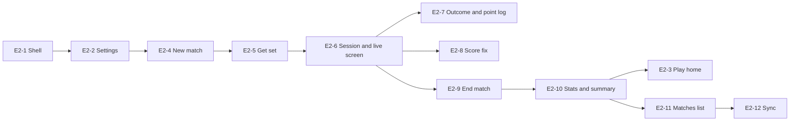

# Epic 2: App shell, new match, manual scoring

Mirrors the [Epic 2 doc](https://claude.ai/artifact/1eVtrbEWuYTAG1VbxxQFkx) (rev 17). Each ticket is a GitHub issue labelled `epic-2`, with native blocked-by links.

## Epic goal

When Epic 2 is done, a player can open Chair, set up a singles or doubles match, score it by tap from the first serve to the final point with the mini court showing who serves from where, fix mistakes with undo and score-fix, and see the finished match with its stats in a history that syncs to Supabase through the offline-first repository. The tab shell (Play, Matches, Train, Coach, Settings) exists with placeholder Train and Coach tabs. No camera, voice, watch, referee or AI.

**Definition of done**

- [ ] A full best-of-3 singles match and a doubles match can be scored by tap from New match to Summary on an iPhone and on an iPad with no camera, no account required
- [ ] Scoreboard, mini court, serve indicator and point log update only from `MatchSession` outputs; no view holds score state of its own
- [ ] A match scored offline reaches the local Supabase stack within 60 s of reconnecting, and a second repository instance using the same test session pulls it (the two-device user check moves to Epic 2a, which adds sign-in)
- [ ] Every screen passes the gallery checks: light, dark, AX5, Reduce Motion, VoiceOver labels on every control
- [ ] Snapshot tests exist for every screen in both size classes

**Out of scope.** Sign in and profiles (Epic 2a; this epic works signed out with local history and reads `AuthService` only to show the account row). Watch (Epic 2b). Umpire voice (Epic 3; this epic shows the announcement text in the status strip). Camera, placement and calibration screens (Epic 4). AI coach card (Epic 9). Paywall and the 20-match cap (Epic 8; the counter is stored here, the gate is not). Train and Coach tab contents (Epics 10 and 9).

**References.** [Chair — Epic roadmap](https://claude.ai/artifact/2fzCeoqNLuP8Dd29BPoXrB) Epic 2 and the wireframe map. [Tennis AI Wireframes](https://claude.ai/artifact/JZ2gzgF491dKiy1h6tBfqN): Tab · Play, Tab · Matches, iPad · Matches, 1 New match, 5 Get set, 6 Live rally (manual parts), 8 Stats, iPad · Live match (manual parts). [Chair — Epic 0](https://claude.ai/artifact/NQi2XJEWVDpNDoV2ZE5mgP) for `ChairUI` components, `CourtView`, `MatchRepository`. [Chair — Epic 1](https://claude.ai/artifact/UFFjDhDrWf5LEMb1S2PxC8) for `MatchSession`, `EngineOutput`, `PreRally`, `MatchLog`.

## Shell and navigation tickets

### E2-1 Tab shell and iPad sidebar (#61)

The five-section shell, adaptive to size class, with the match session as a full-screen modal above it.

- `RootView` in `Features/Root/`: `TabView` on compact width with tabs Play, Matches, Train, Coach, Settings (SF Symbols `play.circle`, `list.bullet.rectangle`, `figure.tennis`, `brain.head.profile`, `gearshape`); `NavigationSplitView` with a sidebar listing the same five on regular width. One `AppRouter` (`@Observable`) holds the selected section and the presented match session, injected via `@Environment`.
- Train and Coach show a `PlaceholderView` ("Coming in a later update") so the shell is complete; Settings shows E2-2.
- The match session is presented with `fullScreenCover` on iPhone and as a full-screen `sheet` with `.interactiveDismissDisabled()` on iPad, so a swipe cannot leave a live match; leaving is only through the End match flow (E2-9).
- Delete `Features/Example/` from E0-1.
- Deep link scheme `chair://match/<id>` opens that match's summary (used by Epic 2a's invite later).

Acceptance:

- [ ] Given an iPhone, when the app launches, then five tabs show with Play selected; given an iPad in landscape, then a sidebar shows the same five with Play selected
- [ ] Given a live match presented, when the user swipes down or taps outside, then the session stays presented
- [ ] VoiceOver reads each tab and sidebar item by its name
- [ ] Snapshot tests of the shell in compact and regular width, light and dark

Blocked by: E0-6, E0-8, E1-9

### E2-2 Settings screen (#62)

Defaults that the New match screen reads, plus the rows later epics fill.

- `SettingsView` sections: Match defaults (format singles/doubles, sets best of 3/5, deuce advantage/no-ad, final set tiebreak 7 / tiebreak 10 / advantage, default player name), Umpire (placeholder toggle, disabled, "available with umpire voice"), Account (row showing `AuthService` state: "Not signed in" for now), About (version, build, links to privacy and support from E0-14's `chair-legal`).
- Defaults stored in `UserDefaults` behind a `MatchDefaults` type in `ChairKit` with a `Fake` in `ChairTestSupport`.
- Default player name pre-fills player A on New match.

Acceptance:

- [ ] Given defaults changed to doubles and no-ad, when New match opens, then those are preselected
- [ ] Given no default name, when New match opens, then player A is "You"
- [ ] Snapshot test in light, dark, AX5

Blocked by: E2-1

### E2-3 Play tab (home) (#63)

Wireframe Tab · Play.

- `PlayHomeView`: New match card (primary, opens E2-4), two shortcut cards (Serve training → Train placeholder; Quick score → E2-4 with input mode manual preselected), Last match card (opens E2-10 summary; hidden when history is empty), This week tiles (matches played, first-serve %, W–L) computed by `MatchStats` (E2-10) over matches in the last 7 days.
- Resume banner at the top when a match with `status == .inProgress` exists: "Resume match vs Opponent" re-presents the session from its saved `MatchLog`.
- Data via `MatchRepository.observe` so the tiles refresh when a match ends.

Acceptance:

- [ ] Given no matches, when Play opens, then New match, the two shortcuts and empty tiles show, and no Last match card
- [ ] Given an in-progress match, when the app relaunches, then the Resume banner shows and tapping it restores the live screen at the same score
- [ ] Given three matches this week with two wins, then the W–L tile reads 2–1
- [ ] Snapshot test in both size classes, light and dark

Blocked by: E2-2, E2-10

## New match flow tickets

### E2-4 New match screen (#64)

Wireframe 1, manual path only.

- `NewMatchView` with `NewMatchViewModel`: format segmented (Singles/Doubles), players (two rows for singles, four for doubles: A1, A2, B1, B2 with free-text names; A1 pre-filled from `MatchDefaults`), rules list (sets, deuce, final set, first server) opening pickers, scoring input segmented (Camera + umpire disabled with "coming soon" and Manual selected), primary button "Start match".
- Doubles adds "Who serves first on team A/B" and "Who receives on the deuce side" pickers per team, which become the `.swapServer` / `.swapReceivers` events sent before the first point (E1-6).
- Start creates a `Match` through `MatchRepository` with `status: .inProgress`, `inputMode: InputMode.manual.rawValue` (this ticket adds `enum InputMode: String { case manual, camera }` in `ChairKit/Models` and a computed `Match.inputModeValue` over the existing string column; the stored type stays a string), a `MatchLog` from the rules, and presents the session (E2-6) via `AppRouter`.
- Validation: names non-empty, no duplicate names within a match.

Acceptance:

- [ ] Given doubles selected, when the screen renders, then four name rows and two per-team pickers show
- [ ] Given a blank name, when Start is tapped, then the row shows an error and nothing is created
- [ ] Given valid input, when Start is tapped, then one `Match` is saved with `status == .inProgress` and the live screen is presented
- [ ] Snapshot test singles and doubles, light and dark, AX5

Blocked by: E2-2

### E2-5 Get-set screen (manual) (#65)

Wireframe 5 without camera: the between-points screen.

- `GetSetView` driven by `PreRally` from `MatchSession`: full-width `CourtView` with server and receiver markers in their court sides and ends, serve-side label ("Aaron serves · deuce side · 1st serve"), the announcement text strip (the last `[Announcement]` rendered as text by a `AnnouncementFormatter` in `ChairKit` that Epic 3 will also use for speech), buttons Swap server / Swap sides / Fix score (E2-8), and a primary "Play point" that goes to the live rally screen.
- Before set 1 and each later set in doubles, Swap server and Swap receivers send the E1-6 events; after the first point they are disabled.
- Singles hides the receiver-swap control.

Acceptance:

- [ ] Given 15–30 with A serving, when get-set shows, then the server marker is on A's end, ad side, and the strip reads the score with the server first
- [ ] Given doubles before the first point, when Swap server is tapped, then the court shows the other partner serving; after one point the button is disabled
- [ ] VoiceOver reads the server, side and score as one sentence
- [ ] Snapshot test singles and doubles, both size classes

Blocked by: E2-4, E0-7

## Live manual scoring tickets

### E2-6 Match session container and live screen (#66)

Wireframe 6 and iPad · Live match, manual parts: the screen a point is scored on.

- `MatchSessionView` owns one `MatchSessionViewModel` (`@Observable`) wrapping Epic 1's `MatchSession` actor; it subscribes to `outputs`, holds the latest `MatchState`, `PreRally` and announcement text, and persists every applied event to `MatchRepository` (append the mapped `PointEvent`, update `Match.sets` and `status`) before returning.
- Phase switching inside the container: `.getSet` (E2-5) → `.rally` (this ticket) → back to `.getSet` after each point; `.complete` → Summary (E2-10).
- Rally screen layout, compact: top strip (set/game label, sets lead), scoreboard (`ScoreboardView`: two rows, names, set games, current points using `Font.chair.scoreLarge`, server dot), mini `CourtView` with positions from `PreRally` and a text block ("Aaron serving · deuce side"), bottom bar with Undo last and the point buttons. Regular width: camera area placeholder on the left (grey panel with "Camera scoring arrives in a later update"), the same side panel as the iPad wireframe on the right.
- Point buttons: "Point Aaron" / "Point Opponent" (56 pt, names from the match), then an outcome sheet (E2-7). "Fault" and "Let" as secondary buttons.
- Pause: a toolbar button that shows a sheet with Resume, Fix score, Swap sides, End match (E2-9).
- Announcement text from `AnnouncementFormatter` shows in the strip for 3 s after each event (static when Reduce Motion is on).

Acceptance:

- [ ] Given love–all, when Point Aaron is tapped and an outcome chosen, then the scoreboard reads 15–love, the event is persisted, and the screen returns to get-set
- [ ] Given the app is killed mid-match, when it relaunches and Resume is tapped, then the scoreboard shows the same score from the persisted log
- [ ] Given regular width, then the side panel shows scoreboard, court and controls without scrolling at 1180×820
- [ ] Every button has a VoiceOver label naming the player; Dynamic Type AX5 keeps the two point buttons on screen
- [ ] Snapshot tests compact and regular, light and dark

Blocked by: E2-5

### E2-7 Point outcome sheet and point log (#67)

How a point ended, and the running list of points.

- `OutcomeSheet` after a point button: five `ChairPill`s (Winner, Unforced error, Forced error, Ace, Double fault) plus Out and Net toggles (`PointEnding`), and a "Skip" that records the point with `outcome: nil`. No Let pill: a let replays the point and has no winner, so it stays on the live screen's Let button. Ace and Double fault are only enabled when the point winner matches (server for ace, receiver for double fault).
- A setting in E2-2 "Ask how each point ended" (default on); when off, the point is recorded immediately with no sheet.
- `PointLogSheet` from the scoreboard tap: the current game's points as rows ("3 · UE backhand · Opponent"), each with a Flip action that applies `.undo` back to that point and re-applies later points with the winner flipped (a `MatchSessionViewModel.flip(pointIndex:)` helper built on the Epic 1 log). Flip is refused with an alert across a set boundary, and on a point whose outcome is `.ace` or `.doubleFault` (the flipped winner could not have that outcome; the alert says to undo and re-enter the point instead).

Acceptance:

- [ ] Given Point Aaron with Aaron receiving, then Ace is disabled and Double fault is enabled
- [ ] Given "Ask how each point ended" off, when a point button is tapped, then no sheet shows and the point is logged with no outcome
- [ ] Given points 1–3 logged, when point 2 is flipped, then the score equals the replay with point 2's winner swapped and points 1 and 3 unchanged; given point 2 is an ace, when Flip is tapped, then an alert shows and the log is unchanged
- [ ] Snapshot test of both sheets, light and dark, AX5

Blocked by: E2-6

### E2-8 Score fix and swap sides (#68)

The manual corrections from the pause sheet and get-set.

- `ScoreFixSheet`: steppers for each side's games in the current set and completed sets, a points picker (love/15/30/40/ad, or tiebreak numbers), server picker; Apply sends `.setScore(ScoreSnapshot)` and shows the `EngineError.invalidScore` reason inline when refused.
- Swap sides sends `.swapEnds`; Swap server (doubles, before a set's first point) sends `.swapServer`.
- Announcements follow the engine: a score fix announces `.correction`; Swap sides announces `.changeEnds`; Swap server announces nothing (the get-set court simply updates). The strip renders whatever the engine emits; no extra announcement is added here.

Acceptance:

- [ ] Given 2–3, when the fix sets 3–3 with A serving, then the scoreboard shows 3–3 and the strip reads Correction; given Swap sides, then the strip reads the change-of-ends text and the court ends flip
- [ ] Given no-ad rules, when the fix picks advantage, then Apply shows "Advantage is not allowed under no-ad rules" and nothing changes
- [ ] Snapshot test, light and dark

Blocked by: E2-6

### E2-9 End match flow (#69)

Leaving a match on purpose.

- From the pause sheet: End match → confirmation with three choices: "Finish as is" (keeps the score, `status: .abandoned`, summary opens), "Retire — Aaron" / "Retire — Opponent" (sends `.retire(side)`, `status: .completed`), Cancel.
- Match completion from the engine (`phase == .complete`) ends the session automatically: a 2 s "Game, set, match" overlay, then Summary.

Acceptance:

- [ ] Given a live match, when Retire — Opponent is chosen, then the match status is completed with Aaron as winner and the summary shows the partial set
- [ ] Given the final point of a match, then the overlay shows and the summary opens without user input
- [ ] Given Finish as is, then the match is `.abandoned`, appears in history, and cannot be resumed

Blocked by: E2-6

## Summary, history and sync tickets

### E2-10 Match stats and summary screen (#70)

Wireframe 8 (Stats and Points tabs) and the detail pane of iPad · Matches.

- `MatchStats` in `ChairKit/Stats`: computed from a `MatchLog` per side: points won, aces, double faults, winners, unforced errors, forced errors, first-serve points (needs fault data: a point after one fault is a second-serve point), break points faced/won, longest game, duration from first to last event. Unit-tested against the Epic 1 singles fixture.
- `MatchSummaryView`: header (date, duration, format, input mode), result line ("Aaron def. Opponent") and set line from `MatchState.summary`, segmented Stats / Points / Coach (Coach shows a locked placeholder until Epic 9), stats table (two columns, rows above), momentum bar (points won in runs, drawn with `Canvas`, no third-party chart), shot map placeholder ("Shot map arrives with camera scoring"), Points tab listing every point with set/game/score context.
- Share: a system share sheet with a text summary ("Aaron def. Opponent 6–4 3–6 7–6(10–7) · Chair").
- Delete match from a toolbar menu with confirmation.

Acceptance:

- [ ] Given the Epic 1 singles fixture, when stats are computed, then aces, double faults and break points match hand-counted values in the test
- [ ] Given a match with no outcomes tagged, then the stats table shows points won only and the other rows read "—"
- [ ] Given the summary on an iPad, then stats and momentum sit side by side with no scrolling at 1180×820
- [ ] Snapshot tests both size classes, light and dark, AX5

Blocked by: E2-9

### E2-11 Matches tab and history list (#71)

Wireframe Tab · Matches and the list column of iPad · Matches.

- `MatchListView` grouped by month, newest first; row shows date, format, duration, opponent names, result badge W/L (or "In progress" / "Abandoned"), set line, and a footer ("118 points · manual"). Filter chips All / Singles / Doubles / In progress. Search by opponent name.
- Regular width: `NavigationSplitView` list + detail (E2-10); compact: push.
- Data via `MatchRepository.observe` with a `MatchListQuery` (filter, search) evaluated in the repository, not in the view.
- Empty state with a New match button.

Acceptance:

- [ ] Given matches in two months, then two section headers show in the right order
- [ ] Given filter Doubles, then only doubles matches show and the count label updates
- [ ] Given an in-progress match row, when tapped, then the session resumes instead of opening a summary
- [ ] Snapshot tests both size classes, light and dark

Blocked by: E2-10

### E2-12 Sync and offline behaviour (#72)

The repository already queues (E0-9b); this ticket wires the app to it and proves it end to end.

- `SyncCoordinator` in `ChairKit/Persistence`: starts on launch and on foreground, watches `NWPathMonitor`, drains the upload queue, then pulls `matches` and `point_events` changed since `lastSyncedAt` for the current `AuthService` session; no session → local only and no network calls. Sign-in UI is Epic 2a. For tests, this ticket adds `AuthService.signIn(email:password:)` compiled only under `#if DEBUG`, used against a seed user in `supabase/seed.sql` (`test@chair.local`, password in the seed file) on the local stack; the release build has no password sign-in.
- Conflicts. Match rows: newest `updated_at` wins. Point events are keyed by `(match_id, index)` and are not append-only since E1-7 (undo rewrites `undone` on an existing row), so the pull merges per event: a new migration (`supabase migration new point_event_updated_at`) adds `updated_at timestamptz not null default now()` to `point_events` with a trigger that bumps it; the repository compares per `(match_id, index)` and keeps the newer `updated_at`. The current pull that replaces all of a match's points is changed to this merge.
- Settings gains a Sync row: last synced time, pending count, "Sync now".
- A 20-match counter (`FreeTier.matchesUsed`) is maintained on the repository for Epic 8; nothing is gated here.

Acceptance:

- [ ] Given airplane mode, when a full match is scored, then every event is `.pendingUpload` and the summary opens normally; when the network returns, then all rows reach the local Supabase stack within 60 s and the pending count reads 0
- [ ] Given two `SyncingMatchRepository` instances signed in as the seed user and separate SwiftData stores, when one scores a match and both sync, then the other's `fetch` returns it; when the first undoes a point and both sync again, then the second's row for that index has `undone == true`
- [ ] Given no session, then no request leaves the app (asserted with a `URLProtocol` stub)
- [ ] `FreeTier.matchesUsed` equals the number of matches with status completed or abandoned

Blocked by: E2-11

## Ticket order

The shell and the new-match flow run in sequence; once E2-6 lands, E2-7, E2-8 and E2-9 can be built in parallel. E2-3 (Play home) waits for stats, so it lands late even though it is the first screen.

Start with E2-1. Epic 2a (accounts) waits on E2-12 for the sync coordinator and owns the real two-device check; Epic 2b (watch) waits on E2-6's `MatchSessionViewModel`; Epic 3 waits on E2-5's `AnnouncementFormatter`.

**Handoff.** File with Claude Code in the repo: `/ticket-workflow file https://claude.ai/artifact/1eVtrbEWuYTAG1VbxxQFkx`
