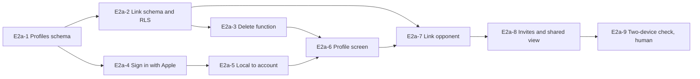

# Epic 2a: Accounts and profiles

Mirrors the [Epic 2a doc](https://claude.ai/artifact/Er5MiFhGvPjgziNif53y24) (rev 13). Each ticket is a GitHub issue labelled `epic-2a`, with native blocked-by links.

## Epic goal

When Epic 2a is done, a player can sign in with Apple, has a profile with a handle, can find another Chair user by handle, link a free-text opponent on any match to that user, and the linked match appears in both players' histories with sides swapped once the other player accepts. Matches scored before sign-in migrate to the account. A user can delete their account. The app still works signed out in no-camera manual mode with local history.

**Definition of done**

- [ ] A new user signs in with Apple and lands on a profile with a handle in under 60 s on a device against the Chair Supabase project
- [ ] Given a match with opponent "Juan", when Juan is linked to a Chair user and accepts, then the match appears in Juan's history with sides swapped and the same point log
- [ ] RLS: a third user cannot read either player's matches; proven by pgTAP and by an integration test with three sessions
- [ ] Deleting an account removes the profile and the user's own matches, unlinks shared matches for the other player, and signs the device out
- [ ] Signed-out users can still start, score and finish a manual match; sign-in later uploads it

**Out of scope.** Friends, feed, head-to-head, leaderboards, opponent suggestions (Epic 11). Avatar upload to Storage (deferred to Epic 11; initials avatar here). Camera and referee roles (Epics 4–7). Paywall (Epic 8).

**References.** [Chair — Epic roadmap](https://claude.ai/artifact/2fzCeoqNLuP8Dd29BPoXrB) Epic 2a. [Chair — Epic 0](https://claude.ai/artifact/NQi2XJEWVDpNDoV2ZE5mgP) E0-9 (`profiles`, `match_players.user_id`, `link_status`, RLS), E0-10 (`AuthService`), E0-12 (Apple provider). [Chair — Epic 2](https://claude.ai/artifact/1eVtrbEWuYTAG1VbxxQFkx) E2-2 (Settings account row), E2-11 (Matches list), E2-12 (`SyncCoordinator`, debug sign-in). Wireframes: 1 New match (player rows), 8 Stats (header), Tab · Matches.

## Backend tickets

### E2a-1 Profile schema, handle rules and auto-create (#86)

One migration that makes `profiles` usable and creates it on sign-up.

- Migration `supabase migration new profiles_v1`, in this order: backfill first (existing rows with null `handle` get `'player_' || left(id::text, 8)`, empty `display_name` becomes "Player"), then the constraints: `profiles.handle` becomes `citext`, not null, unique, 3–20 chars, `^[a-z0-9_]+$` via a check constraint; `display_name` 1–40 chars; `hand` enum `left`/`right`/null; `level` enum `beginner`/`intermediate`/`advanced`/null; `home_court` text null; `created_at`, `updated_at` with a bump trigger. A `handle_available(h citext) returns boolean` function (exact match, case-insensitive, `security invoker` over `public_profiles`) for the profile editor.
- Amend the existing profile auto-create trigger function (it already exists from E0-9): generate `handle = 'player_' || left(uid::text, 8)` and take `display_name` from Apple's full name claim when present, else "Player". No new trigger.
- Visibility: RLS filters rows, not columns, so the `profiles` table stays owner-only for `select` and `update`, and a `public_profiles` view (`id, handle, display_name, level`, `security_invoker = false`) is granted `select` to `authenticated`. Nobody can `insert` or `delete` `profiles` directly (trigger and the delete function do it).
- `profiles_search(q text)` SQL function over `public_profiles`: prefix match on handle, case-insensitive, excludes the caller, limit 20. Plain `security invoker` is enough since the view is readable by `authenticated`.

Acceptance:

- [ ] Given a new auth user, when the trigger runs, then a profile exists with a unique generated handle (pgTAP)
- [ ] Given handle "Aaron!", when updated, then the check constraint rejects it; "aaron_m" is accepted and "AARON_M" collides with it (pgTAP)
- [ ] Given user B, when selecting from profiles for A's id, then zero rows; when selecting from public_profiles, then one row with only id, handle, display_name, level (pgTAP)
- [ ] `make test-db` passes

Blocked by: E0-9

### E2a-2 Match linking schema and RLS (#87)

The rules that let a match belong to two users.

- Migration `supabase migration new match_links_v1`: `match_players` gains `invited_at timestamptz null`, `responded_at timestamptz null`; `link_status` check `none | pending | accepted | declined`. Index on `(user_id, link_status)`.
- RLS on `matches` and `point_events` (replacing E0-9's policies): `select` allowed to the owner and to any user with an `accepted` `match_players` row on that match; `pending` and `declined` grant nothing. `update` and `delete` on `matches`, `point_events` and `match_players` remain owner-only. The invited user never writes `match_players` directly: a `security definer` RPC `respond_to_invite(match_id uuid, accept boolean)` checks the caller has a `pending` row with `user_id = auth.uid()` on that match, sets `link_status` to `accepted` or `declined` and `responded_at = now()`, and raises otherwise.
  - Upload rules for the owner (changes `SupabaseMatchRemote.upsert`, which today deletes and reinserts every `match_players` row): `match_players` is upserted on `(match_id, slot)`; the owner's upsert writes `name`, `user_id`, `link_status` and `invited_at` and never `responded_at`. A `before update` trigger `match_players_guard` keeps the stored answer quietly instead of raising: when `user_id` is unchanged and `old.link_status` is `accepted` or `declined`, it sets `new.link_status := old.link_status` and `new.responded_at := old.responded_at`, so a stale local `pending` re-upload never overwrites the invitee's answer and never fails the owner's sync (sync runs deletes, uploads, then the pull, and a throw would stop the pull for good). Clearing `user_id` (unlink) resets `link_status` to `none` and `responded_at` to null in the same trigger.
  - Swift side: `LinkStatus` gains `.declined`; `MatchRecord.Player` and the SwiftData `MatchPlayer` gain `invitedAt` and `respondedAt`; `Match` and `MatchRecord` gain `ownerID` (mapped from `owner_id` on pull, set to the session user on local creation; nil while signed out); the pull merges `match_players` per `(match_id, slot)` by newest `updated_at` (column added here with a bump trigger).
  - Parent bump: `respond_to_invite` and the `match_players` update trigger also set `matches.updated_at = now()` on the parent row, so the owner's incremental pull (which keys on `matches.updated_at`) sees the answer and the Pending/Linked/Declined chips update.
- A view `my_matches` returning each match once for the calling user with a `role` column (`owner` or `linked`) and the match's `owner_id`, so the client does not need two queries.
- A `pending_invites` view with `security_invoker = false`, filtered on `auth.uid()` inside the view (same pattern as `public_profiles`): matches where the caller has a `pending` row, with the owner's handle and display name and the score so far or final. RLS hides `matches` from a merely pending user, so a plain view would return nothing. The Supabase advisor flags both views as "security definer view" at ERROR level; that is deliberate here and is noted in a comment on each view so it is not "fixed" later.

Acceptance:

- [ ] Given A owns a match and B's row is `pending`, when B selects from `matches`, then zero rows; when B's row is `accepted`, then one row and its `point_events` (pgTAP)
- [ ] Given user C, then `my_matches` and `pending_invites` return nothing for A's match (pgTAP)
- [ ] Given B with a pending row, when B calls `respond_to_invite(match, true)`, then the row is accepted with `responded_at` set; when B updates `match_players` directly, then RLS rejects it; when A upserts the row again with `link_status = pending` and the same `user_id`, then the row stays accepted with its responded_at and the statement succeeds; the parent matches.updated_at moved when B answered (pgTAP)
- [ ] `make test-db` passes

Blocked by: E2a-1

### E2a-3 Account deletion function (#88)

Server-side delete that Apple requires and the client cannot do under RLS.

- Edge Function `delete-account` (verifies the JWT, uses the service role): deletes the user's `point_events`, `matches`, `saved_courts`, `training_sessions`; sets `user_id = null`, `link_status = none` on `match_players` rows that pointed at the user in other owners' matches (keeping the free-text name so the other player's history is intact); deletes the profile; deletes the auth user.
- Runs in one transaction via an RPC `delete_account_data(uid)` the function calls before `auth.admin.deleteUser`.
- Returns 204; 401 without a JWT.

Acceptance:

- [ ] Given A with two matches and one accepted link on B's match, when A deletes, then A's matches and profile are gone, B's match still lists "Aaron" as free text with no `user_id`, and A's auth user no longer exists (integration test on the local stack)
- [ ] `make functions-serve` answers `POST /delete-account` with 401 without a JWT

Blocked by: E2a-2

## Sign-in and profile tickets

### E2a-4 Sign in with Apple (#89)

The real `AuthService` behind E0-10's protocol.

- `SupabaseAuthService` behind the existing protocol shape: the app keeps `ASAuthorizationController` and the nonce (a `SignInWithAppleCoordinator` in `Features/Auth/`) and calls `signInWithApple(idToken:nonce:)`, which exchanges via `supabase.auth.signInWithIdToken`; session persisted by `supabase-swift`'s default keychain storage. The protocol gains `sessionStream: AsyncStream<Session?>` beside `currentSession()`; `signOut()`; the E2-12 debug `signIn(email:password:)` stays under `#if DEBUG`.
- `SignInView`: one screen with the Chair mark, a one-line reason ("Sign in to sync matches and link opponents"), the Sign in with Apple button (`SignInWithAppleButton`, black on light / white on dark), and "Continue without an account". Presented from E2-2's Account row and from the opponent-link flow (E2a-7); the first-launch prompt is E2a-9.
- Apple's name is only given on first sign-in: pass it to `profiles.display_name` right after the session arrives if the profile still reads "Player".
- Errors: cancelled → nothing; network → inline retry; Apple error → alert with the code.

Acceptance:

- [ ] Given a device signed out, when Sign in with Apple completes, then `sessionStream` emits a session, a `profiles` row exists on the Chair project, and the Account row shows the handle (human, on a device)
- [ ] Given the debug sign-in on the local stack, when it completes, then `sessionStream` emits a session (automated)
- [ ] Given Continue without an account, then the sheet dismisses and the app stays local-only
- [ ] Snapshot test light, dark, AX5

Blocked by: E2a-1, E2-12

### E2a-5 Local-to-account migration (#90)

Matches scored before sign-in become the account's matches.

- On the first session after local-only use, every local `Match` is already `pendingUpload` (E2-12) and `matches.owner_id` defaults to `auth.uid()` on insert, so no stamping is needed for matches. What this ticket adds: the local user's slot gets `user_id = session.user.id`, `link_status = accepted`, `responded_at = now()` before upload. The local user's slot is the slot holding the local user, not a fixed A1: `Match` gains `localUserSlot: PlayerSlot` set by `NewMatchSetup` to wherever the "You" row lands after its doubles reseating (team B serving first with A2 as team A's first server puts "You" in A2), and E2-4's doubles reseating is left as it is.
- A one-time sheet "Keep your 3 matches?" with Keep (default) and Discard; Discard deletes the local matches.
- Signing out keeps the local cache but stops sync; signing in as a different user prompts "Replace local data with the new account?" and clears the cache on confirm.

Acceptance:

- [ ] Given two local matches, when the user signs in and keeps them, then both reach the local stack with the user as owner and appear in `my_matches`
- [ ] Given a signed-in cache, when a different user signs in and confirms, then the cache is empty before the first pull
- [ ] Given sign out, then no request leaves the app and history still shows

Blocked by: E2a-4

### E2a-6 Profile screen (#91)

View and edit the user's own profile; view another user's public profile.

- `ProfileView` (own): initials avatar from display name, handle (edit with live availability check via `handle_available`, 400 ms debounce), display name, home court, hand, level; Sign out; Delete account (two-step confirm, calls E2a-3, then signs out and clears the cache).
- `PublicProfileView` (other): avatar, handle, display name, level, and a "Matches with you" count from `my_matches` where that user is linked (0 until Epic 11 adds head-to-head).
- Settings Account row opens `ProfileView` when signed in, `SignInView` when not.
- Profile edits save through a `ProfileRepository` (offline-first like matches: local SwiftData `Profile` row, queued update).

Acceptance:

- [ ] Given handle "aaron_m" taken, when typed, then the field shows "Taken" and Save is disabled; given "aaron_m2", then "Available"
- [ ] Given Delete account confirmed, then the device is signed out, local matches are gone, and the account no longer exists on the local stack
- [ ] VoiceOver reads every field with its current value
- [ ] Snapshot test both screens, light and dark, AX5

Blocked by: E2a-3, E2a-5

## Opponent linking and shared history tickets

### E2a-7 Link an opponent to a user (#92)

From a free-text name to a Chair user, from New match or from a finished match.

- `OpponentPicker`: on any player row except the local user's (`Match.localUserSlot` is labelled "You" and has no Link action) — New match E2-4 rows and a "Link" action on the summary header E2-10 — a search field over `profiles_search`; results show avatar, handle, display name; picking one sets `match_players.user_id` and `link_status = pending`, `invited_at = now()`, and keeps the typed name as fallback.
- Also a QR path: `ProfileView` shows a QR of `chair://user/<handle>`; scanning it from the picker uses `DataScannerViewController`, which needs `NSCameraUsageDescription` in `Info.plist` ("Chair uses the camera to scan a player's QR code and, later, to score matches"); `AppRouter` gains a second host `user/<handle>` beside `match/<id>` that opens the picker with that user selected (or `PublicProfileView` outside a picker).
- Unlink action resets `user_id = null`, `link_status = none` (owner only; allowed at any time). Prune step added to `SyncCoordinator.pull`: after the incremental pull, fetch the id set from `my_matches` and delete any local match whose `syncState == .synced` and whose id is absent (covers unlink, decline, and an owner deleting a shared match); matches still `pendingUpload` are never pruned.
- The row shows a status chip: Pending, Linked, Declined.

Acceptance:

- [ ] Given "aar" typed, when results arrive, then they are prefix matches on handle and the user's own profile is excluded
- [ ] Given a user picked, then the local row has `user_id` and `link_status == .pending` and the upload queue holds the change
- [ ] Given Unlink on an accepted link, then the row is free text again and, after both sync, the other player's `my_matches` no longer lists the match and their local copy is pruned
- [ ] Snapshot test of the picker and the chips

Blocked by: E2a-2, E2a-6

### E2a-8 Invites: accept or decline, and the shared view (#93)

The other side of the link.

- `InvitesView` reachable from a badge on the Matches tab and a banner on Play: lists `pending_invites` (owner handle, date, format, score so far or final); Accept and Decline call `respond_to_invite` (E2a-2) and refresh on success.
- Push notification is out of scope; the badge updates on each pull.
- A linked match renders in the invited user's history with **sides swapped**: `MatchRepository` exposes `Match.perspective(for userID:)` returning a view model where "me" is the side containing the user's slot; the summary, list row and result badge (W/L), and the Play tiles from E2-3 (W–L, first-serve %) all use the perspective; the stored log is untouched.
- Linked (non-owner) matches are read-only: no score fix, no delete, no edit of players; a lock icon and "Scored by @handle" line on the summary. The sync queue skips any match whose `owner_id != session.user.id` (RLS would reject the write); a unit test asserts no upload is attempted for a linked match.

Acceptance:

- [ ] Given a pending invite, when Accept is tapped and sync runs, then the match appears in Matches with the inviter's name on the far side and W/L from the invitee's view
- [ ] Given a declined invite, then it leaves the list and never appears in Matches; the owner sees the Declined chip
- [ ] Given a linked match opened by the non-owner, then Fix score, Delete and player editing are absent
- [ ] Integration test with three sessions on the local stack: A invites B, C sees nothing before and after B accepts

Blocked by: E2a-7

### E2a-9 Two-device sync check and first-launch prompt (#94)

The user-level proof Epic 2 deferred, plus when to ask for sign-in.

- First-launch prompt: after the first completed match while signed out, show `SignInView` once with "Save this match to your account"; never again unless from Settings or a link action.
- Human test on two devices signed into the same Apple ID on the Chair project: score on one, foreground the other.
- Human test on two devices with different users: A links B, B accepts, both histories show the match.
- `docs/QA/epic-2a.md` records the steps and the device/build used.

Acceptance:

- [ ] Given two devices on one account, when a match is scored on device 1, then device 2 shows it within 60 s of foregrounding (human)
- [ ] Given A and B on two devices, when A links B and B accepts, then both Matches tabs show the match with correct perspective (human)
- [ ] Given a first completed match signed out, then the prompt shows once; declining it does not show it again on the next match

Blocked by: E2a-8

## Ticket order

The three backend tickets can land before any screen; The Apple provider is already on in the Chair project, so E2a-4 is unblocked; the device checks in E2a-9 still wait on a test device.

Start with E2a-1. Epic 11 (community) waits on E2a-8's perspective model and `my_matches`; Epic 8 (paywall) waits on E2a-4 for the receipt-to-user link.

**Handoff.** File with Claude Code in the repo: `/ticket-workflow file https://claude.ai/artifact/Er5MiFhGvPjgziNif53y24`
