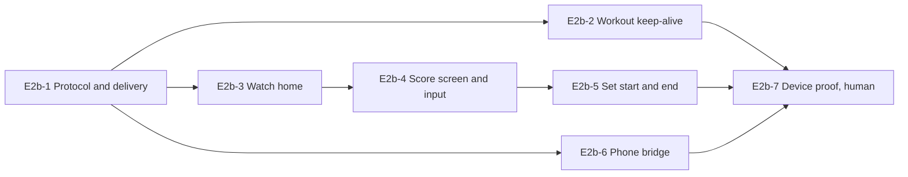

# Epic 2b: Watch manual scorer

Mirrors the [Epic 2b doc](https://claude.ai/artifact/Ckw9qv3rQJcETv6yqQZdRX) (rev 19). Each ticket is a GitHub issue labelled `epic-2b`, with native blocked-by links.

## Epic goal

When Epic 2b is done, a player can start a no-camera match from the phone, put the phone in a bag, and score the whole match from the Apple Watch: Me and Them, fault, let, undo, with the score, server and side always on the wrist and the phone's umpire text strip (voice in Epic 3) following along. The watch stays alive for a 90-minute match, survives going out of range, and never scores a point by accident. The phone owns the engine and the store; the watch is a remote.

**Definition of done**

- [ ] A full best-of-3 singles match is scored from a real Apple Watch with the phone locked in a bag, and the phone's history shows it correctly afterwards
- [ ] The watch stays on the score screen for 90 min on a Series 7 or later via a workout session; wrist-down then wrist-up shows the score within 1 s
- [ ] After the watch is out of range for 2 min and comes back, both devices show the same score within 10 s and no event is lost or duplicated
- [ ] No scoring input fires from a wrist brush or a sweaty forearm: idle-state scoring needs a deliberate gesture, prompted states use large buttons
- [ ] Snapshot tests for every watch screen in ChairWatchTests (ImageRenderer) at 41 mm and 45 mm, AX large text

**Out of scope.** Referee role, disputes, rally-lost prompts, side ownership (Epic 7). Camera positions on the watch court (Epic 5). PicklGo-style gesture scoring (Epic 7 follow-on). Watch-only matches with no phone (the engine stays on the phone). Complications and Smart Stack (later).

**References.** [Chair — Epic roadmap](https://claude.ai/artifact/2fzCeoqNLuP8Dd29BPoXrB) Epic 2b. [Tennis AI Wireframes](https://claude.ai/artifact/JZ2gzgF491dKiy1h6tBfqN): Referee watch · idle state only. [Chair — Epic 0](https://claude.ai/artifact/NQi2XJEWVDpNDoV2ZE5mgP) E0-13 (`ChairWatch` target, `WatchLink`, HealthKit capability). [Chair — Epic 1](https://claude.ai/artifact/UFFjDhDrWf5LEMb1S2PxC8) E1-9 (`MatchSession`, `EngineOutput`, `PreRally`). [Chair — Epic 2](https://claude.ai/artifact/1eVtrbEWuYTAG1VbxxQFkx) E2-6 (`MatchSessionViewModel`), E2-3 (Resume banner).

## Link and keep-alive tickets

### E2b-1 Watch protocol and reliable delivery (#107)

The messages between phone and watch, and how they survive bad connectivity.

- `WatchMessage` (E0-13, today a plain `String` enum with `ping`/`pong`) is replaced by a `Codable` enum with associated values and a new wire format; only E0-13's ping used the old one. Versioned with `protocolVersion: Int = 1`:
  - Watch → phone: `.input(WatchInput)` where `WatchInput` is `.point(Side)`, `.fault`, `.let`, `.undo`, `.swapEnds`, each with `id: UUID`, `at: Date`; `.requestState`; `.endWorkout`. E2b-5 adds `.swapServer`, `.swapReceivers(Side)` and `.endMatch(choice)` to this list.
  - Phone → watch: `.state(WatchState)` (match id, player names, `mySide`, `ScoreSnapshot`, `PreRally` subset: server slot, server court side, first/second serve, and `phase: WatchPhase`), `.ack(inputID: UUID)`, `.announcement(text: String)`, `.matchEnded`. `WatchPhase` is a new enum in `ChairKit` (`.waiting`, `.getSet`, `.rally`, `.complete`) derived by the bridge from the engine's `MatchState.phase` and the app's `SessionPhase`, since the watch cannot see the app target's type.
- Delivery: `sendMessage` when reachable (fast path), else `transferUserInfo` (queued, survives relaunch). Every `WatchInput` is idempotent by `id`: the phone keeps the last 100 applied ids and drops repeats; the watch resends unacked inputs every 3 s up to 30 s, then holds them as pending and shows a "waiting for phone" dot.
- `WatchLink` gains `reachabilityStream` and `pendingInputCount`.
- Shared in `ChairKit` under `#if canImport(WatchConnectivity)`; unit-tested with a `FakeWCSession` on both sides.

Acceptance:

- [ ] Given the phone unreachable, when the watch sends 5 inputs, then they are queued with `transferUserInfo` and all 5 arrive once reachability returns, in order
- [ ] Given an input delivered twice (resend after a lost ack), then the phone applies it once
- [ ] Given `protocolVersion` mismatch, then the watch shows "Update Chair on your iPhone" and sends nothing
- [ ] Given a `.state` with the same snapshot as current, then the watch does not redraw (no flicker)

Blocked by: E0-13, E1-9

### E2b-2 Workout session keep-alive (#108)

Keep the watch app frontmost and running for the whole match.

- `WatchWorkoutController`: starts `HKWorkoutSession` (`.tennis`, `.outdoor`) with `HKLiveWorkoutBuilder` when a match starts on the watch, ends it on match end or explicit End; HealthKit authorization requested once. This ticket adds what E0-13 did not: NSHealthShareUsageDescription and NSHealthUpdateUsageDescription on both the iOS and watch targets ("Chair records your match as a tennis workout so the Watch app stays on while you play"), and WKBackgroundModes = workout-processing on the watch target; the HealthKit entitlement is already present.
- Always On: `WatchScoreView` adapts to `isLuminanceReduced` (score only, no buttons, no animation).
- Haptics via `WKInterfaceDevice`: `.click` on each accepted input, `.notification` on game, `.success` on set, `.failure` on a refused input.
- Workout saved to Health as a tennis workout with duration; heart rate shown as a small number on the idle screen if authorized, nothing else.
- Phone side: `MatchSessionViewModel` sends `.matchEnded` so the watch ends its session; if the phone ends the match while unreachable, the watch ends on the next `.state` with `phase == .complete`.

Acceptance:

- [ ] Given a match joined from the watch, when the wrist drops for 10 min, then the app is still frontmost and the score shows within 1 s of wrist raise (device)
- [ ] Given Always On, then the dimmed state shows score and server only and no control responds
- [ ] Given the phone ends the match, then the workout ends within 5 s and appears in Fitness as Tennis (device)
- [ ] Given HealthKit denied, then scoring still works and the keep-alive falls back to `WKExtendedRuntimeSession` with a one-line notice

Blocked by: E2b-1

## Watch screens and input tickets

### E2b-3 Watch home and match start (#109)

What the watch shows with no match running, and how a match begins.

- `WatchHomeView`: when the phone has an in-progress match the user owns, a "Join match" card (names, score) that sends `.requestState` and opens the score screen (linked, read-only matches from Epic 2a are never offered); otherwise "Start a match on your iPhone" with the last match result and a "New match" button. watchOS cannot bring the iPhone app to the foreground, so New match sends `.openNewMatch` via `transferUserInfo`; the phone stores it as a pending route in `AppRouter` and presents New match (E2-4) the next time Chair comes to the foreground. `AppRouter` gains `pendingRoute` and a `.newMatch` case (the `chair://match/<x>` URL form is not used for this).
- Not reachable: "Open Chair on your iPhone" with a retry.
- Uses `ChairUI` tokens (watchOS build from E0-1): `Font.chair.score`, ink on black.
  - Watch test target: this ticket adds `ChairWatchTests` (watchOS unit test bundle) with a `WatchSnapshot` helper that renders a view with `ImageRenderer` at 41 mm (176×215 pt) and 45 mm (198×242 pt), turns the result into PNG data, and compares it byte-for-byte through `swift-snapshot-testing`'s `assertSnapshot(of:as: .data)` (the .image strategy does not exist on watchOS; byte-for-byte is fine on one pinned watch simulator); `make test` runs it on the paired watch simulator. All later watch screens use it.

Acceptance:

- [ ] Given an in-progress match on the phone, when the watch app opens, then Join match shows the current score from the delivered state (timing measured in E2b-7)
- [ ] Given no match, when New match is tapped, then the next time Chair opens on the phone it presents New match (device)
- [ ] ChairWatchTests exists, runs in make test, and snapshots WatchHomeView at 41 mm and 45 mm

Blocked by: E2b-1

### E2b-4 Score screen and deliberate input (#110)

Wireframe "Referee watch · idle": the screen worn for the whole match.

- `WatchScoreView`: set/game label, two score rows (names truncated to 8 chars, set games, current points in `Font.chair.score`, server dot), a one-line serve strip ("You serve · deuce"), the Me / Them buttons (44 pt tall each). Me maps to mySide from WatchState (the user's own side per E2a-8), Them to the other; for an owner today that is side A, so the acceptance reads .point(.a).
- Deliberate input, to pass the DoD's no-accident rule: Me/Them require a **press-and-hold of 400 ms** with a filling ring (Reduce Motion: a 400 ms delay with a colour change, no ring); release before 400 ms cancels. A setting "Hold to score" (on by default) lives on the watch, in a Settings page of the watch app, stored in the watch's own UserDefaults and not synced; it can switch to single tap for users who want speed.
- Secondary inputs on a vertical page swipe (`TabView(.verticalPage)`): page 2 with Fault, Let, Swap ends, Undo (large buttons, tap only, since they are intentional). Undo also on a **swipe left** on the score rows with a confirming haptic.
- Digital Crown: scrolls between pages only; not an input.
- Announcement text from `.announcement` shows as a 2 s overlay on the score screen (static text when Reduce Motion).
- Doubles: names show as "You + Ana" / "Ben + Cy"; Me/Them stay team-level.

Acceptance:

- [ ] Given a 200 ms touch on Me, then no input is sent; given a 400 ms hold, then `.point(.a)` is sent and a `.click` haptic fires
- [ ] Given a double fault scored on the phone, then the watch shows the new score and "Double fault" overlay from the delivered state (timing measured in E2b-7)
- [ ] Given swipe left on the score rows, then `.undo` is sent and the strip reads Correction after the ack
- [ ] Given AX large text, then both score rows and both buttons stay on screen on 41 mm
- [ ] Snapshot test both sizes, idle and overlay states

Blocked by: E2b-3

### E2b-5 Set start, swaps and end-of-match on the watch (#111)

The doubles choices and the final screen.

- At set start in doubles the watch shows a one-time card "Who serves first for your team?" with the two partner names, sending `.swapServer` if the second is chosen; and "Who receives on the deuce side?" sending `.swapReceivers`. Dismissed after the first point (phone rejects late swaps; watch shows the refusal haptic).
- Match end: `.matchEnded` shows the result ("You won 6–4 3–6 7–6"), Done ends the workout and returns home.
- End match from the watch: a page-3 "End match" opens the same three choices as E2-9 (Finish as is, Retire me, Retire them) and sends a `.endMatch(choice)` input added to `WatchInput`.

Acceptance:

- [ ] Given doubles set 2 starting, when the second partner is chosen, then the phone's get-set shows that partner serving
- [ ] Given the final point, then the result card shows within 2 s and Done ends the workout
- [ ] Given Retire them from the watch, then the phone completes the match with the user as winner

Blocked by: E2b-4

## Phone side, mirroring and proof tickets

### E2b-6 Phone bridge into the match session (#112)

The phone applies watch inputs to the engine and mirrors state back.

- `WatchBridge` (`@Observable`, owned by `AppEnvironment`, not by a view) owns the `MatchSessionViewModel` for the current match; the live screen (E2-6) attaches to that same instance instead of creating its own. The current match is the presented session when there is one, else the most recent in-progress match the user owns. The bridge subscribes to `WatchLink` inputs, maps `WatchInput` → `MatchEvent` with `source: .watch`, applies through `MatchSessionViewModel.apply` (so persistence, announcements and the strip behave identically to a tap), acks by id, and pushes a `.state` after every `EngineOutput` (debounced to one per 100 ms).
- Inputs that arrive while the phone shows the outcome sheet (E2-7) are applied with `outcome: nil` and the sheet is dismissed; the point log can be tagged later.
- When the session is not presented (phone in a bag, app backgrounded), the bridge's own `MatchSessionViewModel` keeps applying inputs in a background task kicked by `WCSession` delivery; presenting the live screen later attaches to it with no catch-up needed. Resume banner (E2-3) covers a killed app.
- Inputs for a match id that is not the current session, or for a linked match the user does not own, are refused with `.ack` plus a `.state` of the current match, so a stale or wrong watch resyncs.
  - Testing: an XCTest target drives one app, so there is no automated paired-simulator test. The bridge is unit-tested in `ChairKit`/`ChairTests` with the `FakeWCSession` from E2b-1 feeding inputs and capturing outgoing messages; the paired-device run is in E2b-7's human list.

Acceptance:

- [ ] Given the live screen open and a `FakeWCSession`, when it delivers `.point(.b)`, then the phone scoreboard updates, the event is persisted with `source == .watch`, and an `.ack` with that id is captured on the fake session
- [ ] Given the app in the background, when the watch sends 3 points, then on foreground the scoreboard shows all 3 and the log has them in order
- [ ] Given the outcome sheet open, when a watch point arrives, then the sheet closes and the point is logged with no outcome
- [ ] Given an input for an old match id, then the watch receives the current match state and the input is not applied
- [ ] Given a linked match the user does not own as the only in-progress match, then the watch home offers no Join card and an input for it is refused

Blocked by: E2b-1, E2-7

### E2b-7 Device proof and battery (#113)

The real-hardware checks the definition of done asks for.

- `docs/QA/epic-2b.md`: steps for a 90-minute watch-scored match (phone locked in a bag), the out-of-range test (walk 2 min away, come back), the accidental-touch test (forearm across the screen 10 times), and the Always On check; record device models, watchOS version, battery at start and end.
- Battery budget: at most 25 % watch drain over 90 min on Series 7 or later; if exceeded, reduce `.state` pushes to game boundaries when the watch is dimmed.
- Paired run (human): a full fixture match scored from a real Watch against the phone, following `docs/QA/epic-2b.md`; the ack latency check (under 500 ms when reachable) is observed here with the debug "last ack" readout on the watch score screen.

Acceptance:

- [ ] Full match scored from the watch, phone history correct afterwards (human)
- [ ] Out-of-range recovery with no lost or duplicated point (human)
- [ ] 10 forearm brushes produce zero inputs (human)
- [ ] Battery drain within budget, recorded in the QA doc (human)
- [ ] The paired run completes with every ack under 500 ms while reachable, Join match showing the score within 2 s, and a phone-scored point reaching the watch within 1 s, recorded in the QA doc (human)

Blocked by: E2b-2, E2b-5, E2b-6

## Ticket order

E2b-1 is the root; the workout keep-alive (E2b-2) and the phone bridge (E2b-6) can be built in parallel with the watch screens (E2b-3 to E2b-5). E2b-7 is the human proof at the end.

Start with E2b-1. Epic 7 (referee and disputes) extends `WatchMessage` and the score screen's prompted states; Epic 5 adds live positions to the watch court.
