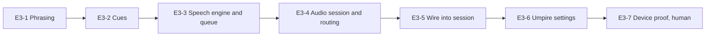

# Epic 3: Umpire voice

Mirrors the [Epic 3 doc](https://claude.ai/artifact/6WDUZUhw6uRRep4DBaTbMg) (rev 10). Each ticket is a GitHub issue labelled `epic-3`, with native blocked-by links.

## Epic goal

When Epic 3 is done, the phone speaks like a chair umpire: a short cue then the call after every rally end ("Ace!", "Out", "Fifteen–love"), the game, set and match calls, change of ends, the pre-rally "Musa to serve, deuce side", and "Correction" after an undo or fix. It plays through a Bluetooth speaker when one is connected and the phone speaker otherwise, keeps speaking with the screen locked, ducks other audio, and can be tuned (voice, volume, verbosity, cues) or muted in Settings. Everything is driven by Epic 1's `Announcement` stream, so camera and no-camera matches sound identical.

**Definition of done**

- [ ] Every `Announcement` case from Epic 1 has text and the Epic 1 golden file renders through `AnnouncementFormatter` with no missing case (a test fails on an unhandled case)
- [ ] A full manual match on a device is called correctly end to end, including "Correction" after an undo, with the screen locked and audio on a Bluetooth speaker (human)
- [ ] Calls start within 300 ms of the engine output on an iPhone 13 and never overlap: a new call queues behind or interrupts per the priority rules
- [ ] Umpire muted, or the device on silent with Respect silent mode on: no speech, no cues, and the text strip still shows every call; with Respect silent mode off (the default) the silent switch has no effect
- [ ] Snapshot tests for the Umpire settings screen; unit tests for the formatter, the queue and the routing decisions

**Out of scope.** Voice input and the "Chair" wake word (Epic 7). Speaking on the watch (watch stays haptic + text). Localisation beyond English (strings go through `String(localized:)` so it is ready, but only `en` ships). Player-name pronunciation editing (later).

**References.** [Chair — Epic roadmap](https://claude.ai/artifact/2fzCeoqNLuP8Dd29BPoXrB) Epic 3 (call list and cues). [Chair — Epic 1](https://claude.ai/artifact/UFFjDhDrWf5LEMb1S2PxC8) E1-2, E1-5, E1-9 (`Announcement` cases and order), E1-10 (golden file). [Chair — Epic 2](https://claude.ai/artifact/1eVtrbEWuYTAG1VbxxQFkx) E2-5 (`AnnouncementFormatter` stub and the strip), E2-2 (Settings Umpire row), E2-6 (`MatchSessionViewModel`). [Chair — Epic 0](https://claude.ai/artifact/NQi2XJEWVDpNDoV2ZE5mgP) E0-10 (`SpeechOutput` protocol). ITF chair-umpire phrasing for the call wording.

## Text and cue tickets

### E3-1 Umpire phrasing (#123)

Every `Announcement` becomes umpire English, in one place.

- `AnnouncementFormatter` in `ChairKit/Announcements` (replacing E2-5's stub): `text(for: Announcement, names: PlayerNames, verbosity: Verbosity) -> String`, exhaustive `switch`, no `default`.
- Scores: server first ("Fifteen–love", "Love–fifteen"), "Fifteen–all", "Thirty–all", "Deuce", "Advantage Musa" (server or receiver named), "Game, Musa"; tiebreak: "Three–two, Musa" (server named), "Six–all"; set: "Game and first set, Musa, six games to four"; match: "Game, set and match, Musa, six–four, three–six, seven–six"; doubles name the team ("Musa–Cruz").
- Calls: `.ace` "Ace!", `.doubleFault` "Double fault", `.out` "Out", `.net` "Net", `.fault` "Fault", `.let(firstServe:)` "Let, first serve" / "Let, second serve", `.changeEnds` "Change of ends", `.retired` "Musa retires; game, set and match, Cruz", `.correction(snapshot)` "Correction" followed by the score read from the snapshot, `.receiverChoosesSide` "Deciding point; receiver's choice", `.chooseServer` "Musa–Cruz, who serves?".
- Pre-rally: from `PreRally`, "Musa to serve, deuce side" on the first point of a game, "Second serve" after a fault; verbosity `.full` repeats the serve side every point, `.normal` only at game start and after faults, `.minimal` says scores and game/set/match only.
- Names: `PlayerNames` carries first name or display name per slot and a `spokenName` override hook (empty now; pronunciation editing is a later epic). Numbers as words so TTS never reads "15" as "fifteen dollars".

Acceptance:

- [ ] Given the Epic 1 singles fixture golden file, when every announcement is rendered at `.normal`, then the output matches a committed `singles_bo3.calls.txt` line for line
- [ ] Given 40–30 with B serving, then the text is "Thirty–forty"
- [ ] Given a tiebreak at 5–6 with A serving, then "Five–six, Musa"
- [ ] Given a new `Announcement` case added without text, then the module fails to compile

Blocked by: E1-10

### E3-2 Sound cues (#124)

The short sound before a call so players react before the words.

- Three bundled cues in `ChairKit/Announcements/Cues/` as CAF, each under 400 ms: `point` (short whistle), `game` (single chime), `set` (double chime); match end reuses `set` then the words. Royalty-free or generated with a synth script checked into `tools/cues/` so they can be regenerated.
- `CueKind` derived from the **highest-ranking** announcement anywhere in an `EngineOutput`, not the first (the engine puts the call first, so "Out, game B" must chime, not whistle): `.gameSetMatch`/`.gameAndSet` → set cue; `.game` → game cue; otherwise any point-ending call or score → point cue; outputs holding only corrections or pre-rally → none.
- Played with `AVAudioPlayer` on the same session as speech (E3-3), gapless into the first utterance.
- Setting "Sound cues" on/off (default on).

Acceptance:

- [ ] Given a point won, then the point cue plays and speech starts within 50 ms of the cue ending (measured with `AVAudioTime` in a unit test against a fake player)
- [ ] Given a set won, then the set cue plays once, not game then set
- [ ] Given cues off, then no cue plays and speech starts immediately
- [ ] Each CAF decodes and is under 400 ms (test asserts duration)

Blocked by: E3-1

## Audio engine and routing tickets

### E3-3 Speech engine and utterance queue (#125)

The real `SpeechOutput` behind E0-10's protocol.

- `UmpireSpeech: SpeechOutput` wrapping `AVSpeechSynthesizer`: `speak(_ calls: [UmpireCall])`, `stop()`, `isSpeaking`. An `UmpireCall` is `(cue: CueKind?, text: String, priority: CallPriority)`.
- Priority and queueing: `.score` (normal), `.call` (ace/out/net/fault, normal), `.structural` (game, set, match, change of ends, correction: high). A call counts as **waiting** until its words begin: while its cue is still playing it can be replaced. A new `EngineOutput` while speaking: if a waiting call is a `.score` and a newer `.score` arrives (fast double-tap scoring), the older one is dropped; a `.score` already in its words finishes. `.structural` interrupts anything after the current word boundary (`stopSpeaking(at: .word)`). Nothing ever overlaps.
- Voice: `AVSpeechSynthesisVoice` chosen in Settings from the installed English voices (Siri voices are not available to `AVSpeechSynthesizer`); default picks the best installed English voice by `quality`: premium, then enhanced, then default, preferring `en-US`; rate 0.5, pitch 1.0; names spoken with `AVSpeechSynthesisIPANotation` hook left empty.
- Latency: the synthesizer is warmed with an empty utterance on session start so the first call is not delayed by voice load.
- `FakeSpeechOutput` in `ChairTestSupport` records calls with timestamps.

Acceptance:

- [ ] Given cues on and three scores applied 100 ms apart, then only the last is spoken (the first two are replaced while still in their 400 ms cue); given cues off, then the first and the last are spoken and the middle one is dropped (fake)
- [ ] Given a score being spoken, when `.game` arrives, then the score is cut at a word boundary and "Game, Musa" follows; the fake records the interruption
- [ ] Given the engine output, then the first utterance starts within 300 ms on an iPhone 13 (device, recorded in QA)
- [ ] Given a voice removed from the device, then the engine falls back to the default voice without throwing

Blocked by: E3-2

### E3-4 Audio session and routing (#126)

Speaker, Bluetooth, silent switch, lock screen, other apps.

- `AVAudioSession` category `.playback`, mode `.spokenAudio`, options `[.duckOthers, .interruptSpokenAudioAndMixWithOthers]`, activated when a match session starts and deactivated with `.notifyOthersOnDeactivation` when it ends. `.playback` means the silent switch does not mute the umpire (intended: a referee's phone on a bench is usually silenced). A Settings toggle "Respect silent mode" (default off) switches to `.ambient`: the silent switch then mutes the umpire, speech also stops when the screen locks, and ducking does not apply; the setting's footer says so ("With this on, the umpire goes quiet on silent and while the screen is locked").
- Background: `UIBackgroundModes` gains `audio` so calls keep playing with the screen locked; the session is kept active between calls only while a match is in progress. iOS may still suspend an app that plays nothing between points, and starting speech from a WatchConnectivity wake is the fragile path, so a **keepalive fallback** is built behind a flag: during a match the session loops a silent 1 s CAF at volume 0 through `AVAudioPlayer`, which keeps the audio process alive. Default off; E3-7's bag test decides whether it ships on.
- Route: no manual picking. `AudioRouting` exposes `currentRouteName` ("Speaker", "JBL Flip", "AirPods") from `AVAudioSession.currentRoute` and a `routePicker` (`AVRoutePickerView`) for the system sheet; E3-5 builds the pill that shows them. Route changes mid-match (speaker disconnects) continue on the new route with a text-strip note.
- Interruptions (phone call): calls are paused; on `.ended` with `.shouldResume`, the latest state is re-announced once ("Thirty–fifteen, Musa to serve").
- Volume: "Umpire volume" slider 50–100 % applied to utterance `volume`; system volume stays the user's.

Acceptance:

- [ ] Given a Bluetooth speaker connected, then calls play on it and the pill names it; given it disconnects mid-match, then the next call plays on the phone speaker and the strip reads "Speaker disconnected" (device)
- [ ] Given the screen locked for 5 min, then calls still play (device)
- [ ] Given music playing in another app, then it ducks during a call and recovers after
- [ ] Given Respect silent mode on and the switch on silent, then no speech and the strip still updates
- [ ] Given a phone call interruption, then the umpire resumes with one re-announcement

Blocked by: E3-3

## Integration, settings and proof tickets

### E3-5 Wire the umpire into the match session (#127)

One place turns engine output into speech.

- `UmpireCoordinator` (`@Observable`, in `ChairApp` beside `WatchBridge`, which lives there since Epic 2b): `MatchSessionViewModel` gains an `outputs: AsyncStream<EngineOutput>` fed from its existing `onChange` closure, so both `WatchBridge` and the coordinator can listen without stealing the closure from each other. The coordinator builds `[UmpireCall]` with `AnnouncementFormatter` + `CueKind` and hands them to `SpeechOutput`. It runs whether the live screen is presented or not (watch-scored matches in a bag still get called).
- This ticket builds the live screen's umpire pill (wireframe 6, "Umpire ON"): tapping toggles `isMuted` for this match only (Settings holds the default), the pill shows the current route name from E3-4's `AudioRouting`, and a long-press opens the route picker. Muted: no cue, no speech, the strip still shows text. Debug builds append the last call's latency (engine output → first utterance start, in ms) to the strip for E3-7's measurement.
- Pre-rally calls fire on `PreRally` changes at game start and after a fault per verbosity; never twice for the same `PreRally`.
- Watch: the phone sends `.announcement(text:)` (E2b-1) from the same formatted text so the wrist overlay and the speaker match word for word.
- `.correction` after undo or score fix reads "Correction" then the snapshot score; a second undo within 2 s coalesces into one correction.

Acceptance:

- [ ] Given a point tapped on the live screen, then the fake speech output receives [cue, score] within one run loop; given the same point from the watch with the live screen closed, then the same calls are produced
- [ ] Given the pill muted, then no `speak` call is made and the strip still updates
- [ ] Given two undos 500 ms apart, then exactly one "Correction" is spoken, with the final score
- [ ] Given the Epic 1 singles fixture replayed through the coordinator, then the spoken sequence equals `singles_bo3.calls.txt`

Blocked by: E3-4, E2-6, E2b-6

### E3-6 Umpire settings (#128)

The Settings section E2-2 left as a placeholder.

- Rows: Umpire on/off (default on), Voice (picker of installed English voices with a "Preview" that says "Fifteen–love"), Verbosity (Minimal / Normal / Full), Sound cues, Umpire volume (slider), Respect silent mode, Output route (opens the system route sheet), and a "Test call" button that plays cue + "Game, set and match".
- Stored in `UmpireSettings` (`UserDefaults`-backed, `@Observable`, with a `Fake`).
- Onboarding nudge: the first time a match starts with no Bluetooth route, the live screen shows a one-time tip "Connect a speaker so everyone hears the umpire" with the route button.

Acceptance:

- [ ] Given a voice chosen, when Preview is tapped, then the fake speech output records that voice id
- [ ] Given Verbosity Minimal, then the next match announces scores and game/set/match only (checked against the fixture)
- [ ] Snapshot test light, dark, AX5

Blocked by: E3-5

### E3-7 Device proof (#129)

The human checks for sound.

- `docs/QA/epic-3.md`: full manual match with a Bluetooth speaker on a court-sized space, screen locked, with one undo and one score fix; a watch-scored game with the phone in a bag; if any call fails to start from the background, repeat with the keepalive flag on and record which setting ships; speaker disconnect mid-match; a phone call during a game; music in another app; silent switch with both settings.
- Record device, iOS version, speaker model, first-call latency as perceived (acceptable if under half a second) and any mispronunciation of the test names (Musa, Cruz, Nguyen, Siobhan).

Acceptance:

- [ ] Every scenario above passes and is recorded (human)
- [ ] First-call latency under 300 ms measured with the debug latency readout on the strip from E3-5 (human)
- [ ] Mispronunciations logged as follow-ups, not blockers

Blocked by: E3-6

## Ticket order

A short chain: text first (testable against the Epic 1 golden file with no audio), then cues, engine, routing, wiring, settings, device proof. E3-1 and E3-2 can land before Epic 2b is merged; E3-5 waits for the watch bridge.

Start with E3-1. Epic 7 adds voice input on the same audio session (`.playAndRecord`) and the "Chair" wake word; Epic 6 adds the confirm-window prompts ("Point, Musa — correct?") as new `Announcement` cases rendered by this formatter.
