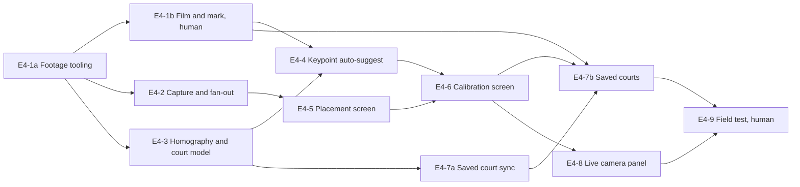

# Epic 4: Camera capture and court calibration

Mirrors the [Epic 4 doc](https://claude.ai/artifact/KDm8623ZojJsprft126M6n) (rev 10). Each ticket is a GitHub issue labelled `epic-4`, with native blocked-by links.

## Epic goal

When Epic 4 is done, a player can choose Camera scoring on New match, be guided to mount the phone (net post, landscape, 0.5× lens, default), see the live camera, confirm auto-suggested court keypoints (named line intersections such as "far singles sideline × service line") or tap them, pass a readiness check, and start the match with a working pixel-to-court mapping that the camera screens use and Epics 5 and 6 build on. The capture pipeline delivers 60 fps frames to consumers without dropping the UI. Calibrations are saved per court and reused. Nothing is tracked yet: no players, no ball, no scoring from the camera.

**Definition of done**

- [ ] On the test footage set, pixel-to-court mapping error is under 15 cm at the sidelines and under 30 cm at the far baseline for the net-post placement, measured against hand-marked ground truth
- [ ] Capture runs at 60 fps 1080p on an iPhone 13 for 90 minutes with the UI responsive and thermal state never above `.serious`
- [ ] Auto-suggested keypoints land within 2 % of the frame width of the hand-marked keypoints on at least 80 % of the test clips; the user can always drag or tap to fix
- [ ] A saved court restores a calibration on the next match at the same place with no re-tap
- [ ] Calibration survives app background and resume; a dropped camera (permission revoked, interruption) shows a clear state and recovers

**Out of scope.** Player tracking and the get-set zones (Epic 5). Ball detection, bounces, score suggestion, clips (Epic 6). Any video recording to disk (Epic 6's 3 s buffer). Training-mode placement (Epic 10). iPad-specific layout beyond what the live screen already does (the camera area fills the left panel). **Known limit:** from the net post (and the umpire chair, which sits beside it) the near sideline is only in view within about 3 m of the net; the deep near alleys cannot be seen, so near-sideline calls deep in the court cannot come from the camera. The far side of the court is what the phone calibrates from and judges.

**References.** [Chair — Epic roadmap](https://claude.ai/artifact/2fzCeoqNLuP8Dd29BPoXrB) Epic 4, tech stack rows Camera and Court mapping, placement decisions. [Tennis AI Wireframes](https://claude.ai/artifact/JZ2gzgF491dKiy1h6tBfqN): 2 Phone placement, 3 Court calibration (landscape, net-side), 1 New match (input mode). [Chair — Epic 0](https://claude.ai/artifact/NQi2XJEWVDpNDoV2ZE5mgP) E0-7 (`CourtView`, court geometry), E0-9 (`saved_courts`). [Chair — Epic 2](https://claude.ai/artifact/1eVtrbEWuYTAG1VbxxQFkx) E2-4 (New match input segmented), E2-6 (camera placeholder panel). ITF court dimensions: 23.77 m × 10.97 m doubles, 8.23 m singles width, service line 6.40 m from the net.

## Capture pipeline tickets

### E4-1a Footage tooling (#138)

The scaffolding every vision ticket is measured against. Code only; the clips come from E4-1b.

- `tools/footage/` README and a `manifest.json` schema: clip id, file name, court, surface, placement (`netPost | baseline | chair`), light, duration, frame rate. Clips live outside the repo in a shared folder named in the README (iCloud Drive folder `Chair Footage`; Aaron to confirm the folder before this is built) and `make footage` copies them into `~/chair-footage/`, which is gitignored. `FOOTAGE_SOURCE` and `FOOTAGE_DIR` are make variables so another machine can point elsewhere.
- Ground-truth schema `ground_truth/<clip>.json`: named court keypoints (`CourtKeypoint` ids, E4-3) in pixels at frame 0 and every 600 frames — the placement's default set for net-post and chair clips, the four outer corners for baseline clips — and at least 10 further line-intersection ground points with pixel and court coordinates in metres. A `Codable` loader in `ChairKitTests/Footage/` plus a one-clip fixture (a synthetic rendered court, 2 s, checked into the test bundle) so the schema and loader are tested without real clips.
- `FootageTests` XCTest suite in `ChairKit` that skips with `XCTSkip` when `~/chair-footage/` is missing so `make test` stays green on a fresh clone; `make test-footage` runs it unskipped and fails if the folder is missing.
- A manifest-vs-ground-truth consistency test: every manifest clip has a ground-truth file, every keypoint id is one the placement's set defines, every ground point lies inside the court bounds.

Acceptance:

- [ ] `make test` on a clone without footage passes with `FootageTests` skipped, not failed
- [ ] `make test-footage` without the folder fails with a message naming `make footage`
- [ ] Given the synthetic fixture clip, then the loader parses its manifest entry and ground truth and the consistency test passes
- [ ] README names the shared folder, carries the recording guide (E4-1b) and says how to add a clip

Blocked by: none

### E4-1b Film and hand-mark the footage set (human) (#139)

The data. Nothing from E4-3 onwards can be judged without it, so start filming now, in parallel with E4-1a.

- 8–12 clips of 30–120 s each, 1080p60, net-post landscape placement, on at least two courts (hard and clay or grass), in bright sun, overcast and evening light, singles and doubles. Plus 2 clips from the baseline placement, 1 from an umpire chair, and one court filmed twice from the net post: once at the normal spot and once 1 m further back (used by E4-7b's mismatch check).
- Recording guide (in the README from E4-1a): phone model noted, 0.5× ultra-wide lens, 60 fps, exposure locked, height 1.5–2 m where possible (note the measured height per clip; include at least two clips at about 1 m so the low-mount case is covered), one clip per setup, a photo of the phone mount for each, plus one full-resolution still from the same position for each net-post and chair clip (what E4-4 detects on). Net-post and chair clips: the far sideline, both far corners and both service-line T's in frame. Baseline clips: all four corners in frame.
- Hand-mark ground truth for every clip per the E4-1a schema; upload the clips to the shared folder and commit the manifest entries and ground-truth files.

Acceptance:

- [ ] `make footage` fetches the set and `make test-footage` finds every clip in the manifest
- [ ] Every clip has ground-truth keypoints for its placement and at least 10 ground points; the consistency test passes on the real set
- [ ] The set covers every placement, light and surface listed above, including the 1 m-further-back pair

Blocked by: E4-1a

### E4-2 Capture session and frame fan-out (#140)

Frames from the camera to any number of consumers without blocking the UI.

- `CaptureSession` actor in `ChairKit/Vision` (iOS only, `#if os(iOS)`): `AVCaptureSession` with the back **0.5× ultra-****wide** camera by default at 1920×1080, 60 fps; the device's `formats` are checked for a 1080p60 ultra-wide format and the chosen lens, resolution and rate are reported in `CaptureState`. If the ultra-wide has no 1080p60 format, fall back to the 1× wide at 60 fps and say so in the readiness pills. `AVCaptureVideoDataOutput` with `alwaysDiscardsLateVideoFrames = true`, pixel format `420v`, on a dedicated serial queue. Exposure and white balance locked after a 2 s settle so lighting changes do not shift line detection; focus locked at the far baseline.
- `FrameFanOut`: consumers register with a priority and a max rate; each gets `CMSampleBuffer`s on its own queue, dropped per consumer when it falls behind, never blocking the capture queue. The on-screen preview is not a consumer: `AVCaptureVideoPreviewLayer` attaches to the session directly. E4-4 registers one consumer; Epics 5 and 6 add theirs.
- Thermal and power: `ProcessInfo.thermalState` observed; at `.serious` the session drops to 30 fps and consumers are told; at `.critical` capture pauses with a user-visible state. `isIdleTimerDisabled` while capturing.
- Interruptions: camera taken by another app, phone call, background → `CaptureState` goes `.interrupted(reason)` and auto-resumes on `.ended`; permission denied → `.unavailable` with a Settings link.
- Orientation: landscape only while capturing; `AVCaptureConnection.videoRotationAngle` fixed so frames arrive upright for the mounted orientation.

Acceptance:

- [ ] Given an iPhone 13, when capture runs for 10 min with two consumers, then the preview stays at 60 fps and no consumer callback runs on the main thread (measured with `os_signpost` in a device test, recorded)
- [ ] Given a slow consumer sleeping 100 ms per frame and a fast consumer registered beside it, then the slow one receives ~10 fps and the fast one still gets 60
- [ ] Given thermal state `.serious` simulated via the fake, then the session reports 30 fps and consumers receive the change
- [ ] Given camera permission denied, then `CaptureState == .unavailable` and the UI shows the Settings link
- [ ] Unit-testable with `FakeCaptureSession` that replays a footage clip's frames at a chosen rate (used by every later vision test)

Blocked by: E4-1a (the clip-replay acceptance also needs E4-1b)

## Court mapping tickets

### E4-3 Homography and court model (#141)

Pixel to metres and back.

- `CourtModel` in `ChairKit/Vision`: the ITF court in metres with the origin at the net centre, x along the net (−5.485…+5.485), y along the court (−11.885…+11.885, positive towards the far end); line segments for baselines, singles and doubles sidelines, service lines, centre service line, centre marks; `isIn(point, singles: Bool) -> LineCall` returning `.in`, `.out`, or `.onLine(distance)` for a ball mark with a given radius.
- `Homography`: built from any 4 or more named keypoints with their pixel positions, by least-squares DLT with `simd` / Accelerate, normalised for conditioning; refuses sets with fewer than 4 points or any three collinear; `toCourt(pixel) -> CourtPoint?` and `toPixel(court) -> CGPoint`; returns nil for points at or beyond the horizon.
- `CourtKeypoint`: an enum naming each court line intersection (far-left doubles corner, far singles sideline × baseline, far singles sideline × service line, service T, and so on, both sides, near and far) with its `CourtPoint` in metres. `CourtKeypoint.defaultSet(for: CameraPlacement)`: net post and chair share 8 points on the far side (both far doubles corners, the far singles sideline at each baseline end and at each service-line end, and the two service-line T's); baseline uses the four outer doubles corners.
- Lens distortion: not corrected in this epic. The single 1× wide camera does not deliver `AVCameraCalibrationData` for video; at most the per-frame intrinsic matrix (`isCameraIntrinsicMatrixDeliveryEnabled`) is available, with no distortion coefficients. `Homography` takes an optional `Undistorter` hook that is a no-op now, so a calibrated model can be added later if the footage numbers demand it; the E4-1b accuracy figures measure the uncorrected mapping.
- Accuracy estimate: from the fitted homography, compute the metres-per-pixel at the far sideline, the far baseline and the service line; expose `CalibrationQuality` (`sidelineError`, `baselineError` in cm at one pixel, `reprojectionError` in pixels — the RMS distance between each keypoint's tapped position and its reprojection) for the readiness pills and for Epic 6's confidence.
- `CourtPoint` ↔ `CourtView` coordinates (E0-7) through one shared mapping so what the mini court draws matches what the homography says.
- `CourtCalibration` value type defined here: the keypoints (`[CourtKeypoint: CGPoint]`), `placement`, lens (`.ultraWide` or `.wide`), frame size, optional intrinsics id, `CalibrationQuality` and a date; `Codable` with a stable JSON shape and a `homography` accessor. E4-6 produces it, E4-7a stores it, E4-8 and Epic 5 read it.

Acceptance:

- [ ] Given each footage clip's ground-truth keypoints, when its 10 ground points are mapped, then the mean error is under 15 cm at the far sideline and under 30 cm at the far baseline for net-post and chair clips, under 20 cm everywhere for baseline-placement clips
- [ ] Given a synthetic court rendered with a known camera, then round-tripping 100 random court points through `toPixel` then `toCourt` errs by under 1 cm
- [ ] Given a ball mark 3 cm outside the sideline with a 3.3 cm radius, then `isIn` returns `.onLine`; at 7 cm outside, `.out`
- [ ] A keypoint on the horizon returns nil and does not crash; a set with three collinear points or fewer than four points is refused with a reason

Blocked by: E4-1a (the footage accuracy acceptance needs E4-1b; the synthetic and unit checks do not)

### E4-4 Keypoint auto-suggest from line detection (#142)

Find the court before the user taps.

- `CourtLineDetector`: runs on a **high-resolution still**, not a 1080p stream frame. From the net post a 5 cm far line is under half a pixel tall at 1080p, so `CaptureSession` exposes `captureStill() async -> CVPixelBuffer` (`AVCapturePhotoOutput` at the sensor's full resolution on the active lens, or a brief 4K format switch where photo output is unavailable) and the detector takes that. On it: `VNDetectContoursRequest` on a white-line mask (adaptive threshold on luminance plus a colour gate for white against green/blue/clay), then Hough-style line fitting of the long contours, grouping into the near-horizontal families (far baseline, service lines) and the converging sidelines; the intersections of the fitted lines are matched to the placement's `CourtKeypoint` set and returned as candidate keypoints, scaled back to the 1080p frame's coordinates. Runs off the main thread, under 600 ms on an iPhone 13 including the still capture.
- Scoring: candidate keypoint sets are scored by how well the projected `CourtModel` lines overlap the mask (reprojection); the best is returned with a confidence 0–1 and any keypoint not found is omitted. Below 0.5 overall, no suggestion is shown and the user taps from scratch.
- Repeated every 2 s while the calibration screen is open and no keypoint has been touched; stops once the user drags any handle.
- Debug overlay (debug builds) showing the mask and detected lines.

Acceptance:

- [ ] Given every footage clip's frame 0, then suggested keypoints are within 2 % of frame width of ground truth on at least 80 % of clips; the test prints the per-clip, per-keypoint error table
- [ ] Given a frame with no court (sky), then confidence is under 0.5 and no keypoints are suggested
- [ ] Still capture plus detection on an iPhone 13 completes in under 600 ms (device, recorded); the 1080p60 stream is not interrupted for longer than one still

Blocked by: E4-3, E4-1b

## Screens, saved courts and proof tickets

### E4-5 Placement guide screen (#143)

Wireframe 2.

- `PlacementView`, pushed from New match when input mode is Camera. E2-4 shows a static "Camera + umpire · Coming soon" row today; this ticket replaces it with a selectable Camera `InputMode` case. Top-view illustration (`Canvas`, reusing `CourtView`'s geometry) with the phone marked at the net post and the field of view shaded as a wide wedge (about 108°, the 0.5× lens); checklist (landscape, 0.5× lens, height 1.5–2 m where possible — fence post, tripod or net-post clamp — and never under 1 m, far sideline and both far corners in frame, net post clear of the near sideline); a one-line note that higher is better because the far lines are thin from the net; an alternatives disclosure for baseline and umpire-chair placements with their trade-offs in one line each; "Open camera" primary.
- Placement choice is stored on the match (`cameraPlacement: .netPost | .baseline | .chair`) and passed to the calibration screen, which picks the keypoint set and the handle labels for it.
- Camera permission requested here, not earlier. `NSCameraUsageDescription` was added in Epic 2a for the QR scanner; verify it is in `Info.plist` and add it if missing.

Acceptance:

- [ ] Given New match with Camera chosen, when Start is tapped, then Placement shows before the live screen
- [ ] Given permission not yet asked, when Open camera is tapped, then the system prompt appears; given denied, then the screen shows the Settings link instead of the camera
- [ ] Snapshot test, light and dark, AX5, both size classes

Blocked by: E4-2

### E4-6 Calibration screen (#144)

Wireframe 3, landscape.

- `CalibrationView` (forces landscape): full-screen `CaptureSession` preview; one draggable handle (44 pt) per keypoint in the placement's set, each labelled with its name ("Far left corner", "Left service T", …), pre-placed from E4-4 when confidence is at least 0.5 else placed by tapping in the listed order; the projected `CourtModel` lines drawn through the homography as soon as 4 points are placed so the user sees the fit; progress dots; Redo. A keypoint that is out of frame can be skipped.
- Magnifier loupe while dragging a handle (3×, 100 pt), since intersections are small on screen.
- Readiness pills from E4-2 and E4-3: far sideline and both far corners in frame, lens and 60 fps and light (`CaptureSession` reports lens, fps and mean luminance), far-baseline accuracy from `CalibrationQuality` ("Baseline depth ±30 cm" as a warning, "±15 cm" as OK), reprojection error ("Fit 3 px" OK, over 8 px warning). "Next" enables when 4 or more keypoints are placed with no three in a line.
- Result: a `CourtCalibration` value (keypoints, placement, lens, intrinsics id, quality, date) attached to the match session and passed to Epic 5's player tracking via the session.
- Persistence: `CourtCalibration` is stored on the match (`Match.calibration` SwiftData field and a `calibration jsonb` column on `matches` via a new migration, synced like the other match columns) beside `cameraPlacement`, so a match killed and relaunched resumes with its calibration; the copy on the session is a cache of it.
- iPad: same screen, handles scale with the view.

Acceptance:

- [ ] Given a footage clip through `FakeCaptureSession`, when the screen opens, then handles appear at the auto-suggested keypoints within 2 s and the projected lines overlay the real lines
- [ ] Given a handle dragged 40 px, then the projected lines update live and the far-baseline pill recomputes
- [ ] Given three placed keypoints in a line (or fewer than four placed), then Next is disabled and a hint explains
- [ ] Given the app backgrounded and resumed on this screen, then the keypoints and preview are restored
- [ ] Given the app killed during a camera match and relaunched, when the match resumes, then its calibration is restored from the match without re-tapping
- [ ] Snapshot test at 844×390 and 1180×820, light and dark

Blocked by: E4-4, E4-5 (the clip acceptances need E4-1b)

### E4-7a Saved court sync (#145)

`SavedCourt` exists only as a local SwiftData model today and `saved_courts` has no `updated_at`; nothing syncs it. Make it a real synced record before the UI relies on it.

- Migration `<yyyyMMddHHmmss>_saved_courts_calibration.sql`: add `calibration jsonb` (the `CourtCalibration` JSON, keypoints included), `last_used_at timestamptz`, `latitude double precision`, `longitude double precision` (nullable), `updated_at timestamptz not null default now()` with the shared bump trigger. Drop the old `corners` column (superseded by `calibration.``keypoint``s`); keep `placement` and reuse it for `CourtCalibration.placement`. RLS unchanged (owner only). pgTAP in `make test-db`.
- `SavedCourt` SwiftData model gains `calibration`, `lastUsedAt`, `latitude` / `longitude`, `updatedAt` and sync state; the thumbnail path stays local only.
- `SavedCourtRepository` protocol and `SyncingSavedCourtRepository` following `SyncingMatchRepository`: queue on write, push, pull on sign-in and foreground, last-write-wins by `updated_at`, deletes as tombstones. `delete-account` already removes `saved_courts` rows; add that to its test if missing.

Acceptance:

- [ ] `make test-db` passes with the new columns, trigger and RLS covered
- [ ] Given a saved court written offline, when the device goes online, then it appears in Supabase; given it edited on a second device, then the newer `updated_at` wins on both
- [ ] Given sign-out and a different account, then no saved courts from the first account are visible
- [ ] `FakeSavedCourtRepository` for the UI tests in E4-7b

Blocked by: E4-3

### E4-7b Saved courts (#146)

Skip calibration at a known court.

- Saved court record: the `CourtCalibration`, placement, `lastUsedAt`, an optional thumbnail (the calibration frame at 320 px, JPEG, local file, not synced), and location when "Use location to find courts" is on in Settings › Camera (off by default; `NSLocationWhenInUseUsageDescription` added; a one-shot `CLLocationManager` request on calibration open, never continuous).
- Privacy: synced location is a new data type. Update the chair-legal privacy page (location, used to match saved courts, stored with the account, removed with the court or the account) and the App Store privacy label (Precise Location, linked to the user, App Functionality) before the build that ships this is submitted. Listed as a checklist item in the ticket, done by Aaron.
- After Next on calibration: "Save this court?" with a name field (default "Court 1"); saved through `SavedCourtRepository` (E4-7a).
- On calibration open with a saved court nearby (within 50 m) or when the user picks one from a "Saved courts" button: the saved keypoints are placed and the auto-suggest is run once as a sanity check; if the shared keypoints disagree by more than 3 % of frame width the screen says "Phone position differs from last time" and keeps the saved keypoints editable.
- Settings › Camera gains the location toggle and a Saved courts list with rename and delete.

Acceptance:

- [ ] Given a saved court and the same clip, when calibration opens, then keypoints are placed without tapping and Next is enabled
- [ ] Given a saved court and the E4-1b clip of the same court from 1 m further back, then the mismatch notice shows and the keypoints stay editable
- [ ] Given the location toggle off (default), then no location prompt ever appears and saved courts are selectable by name; given permission denied, the same
- [ ] Saved courts appear on a second device via sync; thumbnails do not
- [ ] Privacy page and App Store label updated (human)

Blocked by: E4-6, E4-7a, E4-1b

### E4-8 Live camera panel (#147)

Show the calibrated camera during play, so the mapping the match starts with is visible and the placeholder goes away.

- The live screen's camera panel (iPhone: the top area of wireframe 6; iPad: the left panel of the iPad live wireframe) shows the `AVCaptureVideoPreviewLayer` with the projected `CourtModel` lines drawn through the match's `CourtCalibration`, replacing "Camera scoring arrives in a later update" whenever the match has a calibration.
- Capture state banner over the panel from E4-2: `.interrupted(reason)`, `.unavailable` with the Settings link, thermal 30 fps and paused. A "Recalibrate" button reopens E4-6 with the current keypoints and updates the match's calibration on Next.
- The REC / fps chip from the wireframe shows fps and "Calibrated" only; tracking counts arrive with Epic 5.
- Nothing consumes frames here beyond the preview; manual scoring, the umpire voice and the watch keep working exactly as in Epics 2, 2b and 3 while the camera shows.

Acceptance:

- [ ] Given a camera match, when the live screen opens, then the preview and overlay appear within 1 s and the outcome pills, undo and umpire voice still work
- [ ] Given the camera interrupted by a phone call, then the banner shows and the preview resumes after the call
- [ ] Given Recalibrate, then the calibration screen opens with the current keypoints and the match's calibration changes on Next
- [ ] Snapshot test of the panel with `FakeCaptureSession` on iPhone portrait and iPad landscape, light and dark

Blocked by: E4-6

### E4-9 Field test (#148)

On a real court.

- `docs/QA/epic-4.md`: net-post, baseline and chair placements on two courts with the 0.5× lens; bright and dusk; measure the mapping with a tape: drop a ball at 6 marked spots per court (far sideline, far baseline, service line, centre, two far mid-court; plus one near-sideline spot 2 m from the net to confirm the near-side limit), compare the app's court coordinates (debug readout on the calibration screen) with the tape; record device, lens, light, and thermal state and battery every 30 min through a 90-minute capture on the live screen (E4-8).
- Target: under 15 cm at sidelines, under 30 cm at the far baseline, matching the DoD; log anything worse with the photo of the setup.

Acceptance:

- [ ] All placements and light conditions measured and recorded (human)
- [ ] 90-minute capture at 60 fps on an iPhone 13 stays below thermal `.serious` with the UI responsive throughout, matching the DoD (human)
- [ ] Any spot over target has a logged follow-up with its cause (lens, keypoint placement, distortion)

Blocked by: E4-7b, E4-8

## Ticket order

The footage tooling (E4-1a) has no blockers and the filming (E4-1b, human) should start the same day. Capture (E4-2) and the court model (E4-3) can be built and unit-tested before the clips arrive; the auto-suggest, the clip-based acceptances and the field test wait on E4-1b. Saved-court sync (E4-7a) can run beside the screens.

Start with E4-1a and get the clips filmed in parallel; E4-2, E4-3 and E4-7a fill the wait. Epic 5 consumes `FrameFanOut`, `CourtCalibration` and `FakeCaptureSession`; Epic 6 adds `CalibrationQuality` to its confidence and may plug a real `Undistorter` into `Homography`.

**Handoff.** File with Claude Code in the repo: `/ticket-workflow file https://claude.ai/artifact/KDm8623ZojJsprft126M6n`
