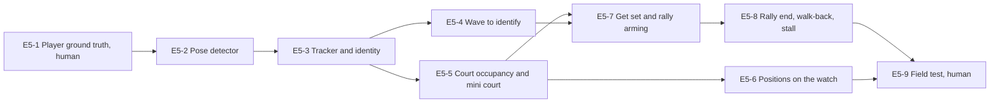

# Epic 5: Player tracking and get-set

Mirrors the [Epic 5 doc](https://claude.ai/artifact/9vnf1r455Rabichgqm7DN6) (rev 2). Each ticket is a GitHub issue labelled `epic-5`, with native blocked-by links.

## Epic goal

When Epic 5 is done, a camera match knows where each player is. Players identify themselves by raising a hand on the Players screen, are tracked through the match without swapping identities, and their positions show live on the mini court on iPhone and iPad and on the watch. Before each point the Get set screen shows who should stand where (server, receiver, partners; deuce or ad side) from the score, marks each player set or move, and arms rally detection only when everyone is set. The tracker also tells the session when a rally has started and when the players have walked back, so Epic 6 has a rally window to judge and the "rally not detected" fallback has something to anchor to. In no-camera mode the same court view still shows server, receiver and sides from the score, without live positions. Nothing judges the ball yet.

**Definition of done**

- [ ] Two (singles) or four (doubles) players are tracked through a 10-minute test clip with no identity swap
- [ ] On the labelled footage, each player's foot position is within 0.5 m of ground truth on at least 90 % of marked frames
- [ ] The Get set screen marks each player set or move from the score's expected positions and arms rally detection only when all are set; on labelled rally starts it is armed at the serve on at least 90 %
- [ ] Positions reach the watch within 500 ms at no more than 2 Hz, and the manual-mode court view shows server, receiver and sides from the score alone
- [ ] Pose runs at 15 fps beside the 60 fps capture on an iPhone 13 for 90 minutes without the thermal state passing `.serious`

**Out of scope.** Ball detection, bounces, in/out, point suggestion and clips (Epic 6). Hand-up as an objection gesture and the "Chair" wake word (Epic 7). Pose metrics for training (Epic 10). Spectator or coach tracking. Any face recognition: identity is a slot assigned by a wave and kept by tracking, never a face.

**References.** [Chair — Epic roadmap](https://claude.ai/artifact/2fzCeoqNLuP8Dd29BPoXrB) Epic 5, locked decisions on positions mirrored to the watch and the 5 s auto-accept. [Tennis AI Wireframes](https://claude.ai/artifact/JZ2gzgF491dKiy1h6tBfqN): 4 Identify players, 5 Get set, 6 Live rally, iPad live, Referee watch states. [Chair — Epic 1](https://claude.ai/artifact/UFFjDhDrWf5LEMb1S2PxC8) `PreRally` (server, receiver, `CourtSide`, `CourtEnd`), `PlayerSlot`. [Chair — Epic 2b](https://claude.ai/artifact/Ckw9qv3rQJcETv6yqQZdRX) E2b-1 `WatchMessage` wire format. [Chair — Epic 4](https://claude.ai/artifact/KDm8623ZojJsprft126M6n) `FrameFanOut`, `CourtCalibration`, `CourtModel`, `FakeCaptureSession`, the footage set and its near-sideline limit.

## Ground truth and detection tickets

### E5-1 Player ground truth and identification clips (human) (#174)

What the tracker is measured against. Filmed in the same sessions as E4-1b, so add this to that shoot list.

- Every net-post and chair clip starts with an identification pass: each player in turn raises one hand above the head for 2 s in slot order (A1, A2, B1, B2), then walks to a get-set position. Note the slot order on the clip's manifest entry.
- At least one singles and one doubles clip of 10 minutes or longer, continuous, with real points played, for the no-swap check.
- `players/<clip>.json` in the footage set: at frame 0 and every 300 frames, each visible player's slot and foot-point pixel (midpoint between ankles) plus the frame's rally state (`gettingSet`, `set`, `inRally`, `walkBack`); and a list of rally segments with start frame (serve contact) and end frame (ball dead) per clip. Court coordinates are derived through the E4 ground-truth homography by the loader, not typed by hand.
- Schema and loader land in `tools/footage/` with the E4-1a consistency test extended: every slot in `players/` exists in the manifest's slot order, foot points fall inside the court plus a 3 m margin.

Acceptance:

- [ ] Every net-post and chair clip has a `players/` file; the two long clips are in the manifest flagged `longRun`
- [ ] The consistency test passes on the real set with the player files
- [ ] README documents the identification pass and the marking procedure

Blocked by: E4-1b

### E5-2 Pose detector (#175)

People in the frame, as skeletons with a point on the ground.

- `PoseDetector` in `ChairKit/Vision` (`#if os(iOS)`, `canImport(Vision)`): a `FrameFanOut` consumer at a max rate of 15 fps running `VNDetectHumanBodyPoseRequest` on each frame's region of interest (the calibration's court quad expanded by 15 %, so spectators beside the court are mostly excluded before detection). Output per frame: `[DetectedPerson]` with the 19 joints and confidences, a bounding box, and a `footPoint` in pixels (midpoint of the ankle joints when both are above 0.3 confidence, else the lowest confident joint of the hip–knee–ankle chain) mapped to `CourtPoint` through the match's `CourtCalibration`.
- Drops detections whose court point lies more than 3 m outside the doubles lines or whose box is under 40 px tall; reports the number dropped for the debug overlay.
- Thermal: on `.serious` the max rate falls to 10 fps; on capture paused the detector idles and emits `.noFrames`.
- Debug overlay (debug builds) drawing skeletons and foot points on the E4-8 live panel.
- `FakePoseDetector` that replays `players/` ground truth as detections, for every later test that does not need Vision.

Acceptance:

- [ ] Given each labelled clip through `FakeCaptureSession`, when the marked frames are detected, then every marked player has a detection whose court point is within 0.5 m on at least 90 % of marked frames, and the per-clip table is printed
- [ ] Given a frame with a spectator 5 m outside the court, then no detection is emitted for them
- [ ] Detection of one 1080p frame on an iPhone 13 completes in under 45 ms on average, off the main thread (device, recorded)
- [ ] Given thermal `.serious` from the fake capture, then the detector's rate drops to 10 fps

Blocked by: E4-2, E4-3, E5-1 (accuracy acceptance only)

### E5-3 Player tracker and identity (#176)

Turn detections per frame into the same four people over time.

- `PlayerTracker` actor: assigns each frame's `DetectedPerson`s to existing `TrackedPlayer`s by Hungarian assignment on a cost of predicted court position (constant-velocity prediction) plus an appearance term (a 16-bin hue histogram of the torso region, updated slowly); unassigned detections open a tentative track that is confirmed after 5 consecutive frames; a track unseen for 2 s is marked `.lost` and for 10 s is dropped.
- `TrackedPlayer`: `id`, `slot: PlayerSlot?` (nil until E5-4 assigns it), `courtPosition`, `velocity` (m/s), `end: CourtEnd`, `lastSeen`, `confidence`, `isLost`.
- End constraint: a confirmed track never jumps across the net in one step; a candidate assignment that would do so is rejected, which is what stops two players swapping when they cross near the net post.
- Swap recovery: when two tracks on the same end have been within 1 m of each other, the next 30 frames re-score assignment with the appearance term weighted up; if the slots look swapped (appearance disagrees for 15 frames), the slots are swapped back and a `.identityCorrected` event is emitted for the debug log.
- Output: `AsyncStream<TrackerFrame>` (timestamp, players, dropped count) at the detector's rate.

Acceptance:

- [ ] Given the singles and the doubles `longRun` clips through `FakePoseDetector`, then every marked frame has each slot's track within 0.5 m of its ground truth, with zero identity swaps over the full clip
- [ ] Given two tracks that cross near the net post in a clip, then neither crosses the net and the swap-recovery path is exercised (asserted via the event)
- [ ] Given a player leaving the frame for 5 s and returning, then the same track resumes with the same slot
- [ ] Given a frame of synthetic detections with one false positive, then no tentative track is confirmed from it

Blocked by: E5-2

## Identification and positions tickets

### E5-4 Wave to identify (#177)

Wireframe 4. Who is A1, A2, B1, B2.

- `IdentifyPlayersView` after calibration (E4-6) and before Get set: the live preview with tracked people outlined; a prompt per slot in order ("Aaron, raise your hand", using the match's player names); the track whose wrist joint stays above the head joint for 1 s takes the slot, flashes the name on the outline and the prompt advances. Doubles asks four, singles two.
- Fallback: tap an outline to assign the current slot; long-press an assigned outline to clear it.
- Side check: when all slots are assigned, the ends implied by the tracks are compared with the score's `CourtEnd` for each team (Epic 1 `PreRally`); a mismatch offers "Swap ends" (sends the engine's swap, as E2b-5 does) or "Re-identify".
- No-camera matches skip this screen. Referee mode is not built yet (the refereeMode column is stored but nothing reads it, Epic 7); when it lands, referee devices skip this screen too.
- `IdentificationState` lives on the session so a backgrounded app resumes mid-identification.

Acceptance:

- [ ] Given the labelled doubles clip's identification pass, then all four slots are assigned to the right tracks without a tap
- [ ] Given a player who does not raise a hand within 15 s, then the hint shows the tap fallback and tapping assigns the slot
- [ ] Given ends that disagree with the score, then the Swap ends sheet shows and accepting it swaps the engine's ends
- [ ] Snapshot test, light and dark, iPhone landscape and iPad

Blocked by: E5-3, E4-6

### E5-5 Court occupancy and the mini court (#178)

One model for "who stands where", from the camera when there is one and from the score when there is not.

- `CourtOccupancy` in `ChairKit`: per `PlayerSlot`, `role` (server, receiver, serverPartner, receiverPartner), `expectedZone: CourtZone`, `position: CourtPoint?`, `status` (`.set`, `.move`, `.unknown`). Built by `OccupancyBuilder` from the engine's `PreRally` (server, receiver, `CourtSide` deuce/ad, `CourtEnd` per team) and, when present, the latest `TrackerFrame`.
- `CourtZone` already exists in `ChairUI` (`CourtMarks.swift`: `id`, `from`, `to`). Move it into `ChairKit` beside `CourtModel` (ChairUI re-exports it so nothing else changes) and extend it with a `role` and a `contains(_ point: CourtPoint, margin:)` test. Zone definitions, generous for recreational play: server behind the baseline (0–4 m past it) on the correct half of the centre mark for the side being served; receiver on the diagonal half between the service line and 4 m behind the baseline; server's partner and receiver's partner anywhere on their own end and not inside the other player's zone. Zones stay `CourtModel` rectangles so they draw on `CourtView` and on the watch.
- Build on what Epic 2 drew, do not add a layer beside it: the existing `PlayerMarker` and `CourtPoint.behindBaseline` already place server, receiver and partners from the score on the Get set screen. `PlayerMarker` gains `status` (`.set` green ring, `.move` amber ring, `.unknown` dimmed), an optional live `position: CourtPoint` that overrides the score-derived default, and the zone drawn as a tinted rectangle behind it. `CourtView` takes a `CourtOccupancy` and renders the markers from it, so the live screen (E2-6 / E4-8), the iPad side panel and the Get set screen all draw from the same model; in no-camera matches `position` is nil and the markers sit at the zone centres exactly as today.
- Positions animate at the tracker rate with a 100 ms smoothing so dots do not jitter.

Acceptance:

- [ ] Given `PreRally` for every serve of a recorded singles and doubles match (Epic 1 fixtures), then the expected zones match a golden file `occupancy_bo3.txt` for every point, including after change of ends
- [ ] Given a `TrackerFrame` with a player inside their zone moving under 0.5 m/s for 1 s, then status is `.set`; outside it, `.move`; with no track, `.unknown`
- [ ] Given a manual match, then `CourtView` shows server, receiver and sides at zone centres with no live dots, and the Epic 2 Get set snapshots are unchanged
- [ ] Snapshot test of `CourtView` with occupancy, singles and doubles, both ends, light and dark, iPhone and watch sizes

Blocked by: E5-3

### E5-6 Positions on the watch (#179)

Mirror the mini court to the referee's or player's wrist.

- `WatchState` (the payload of `WatchMessage.state`, E2b-1) gains `occupancy: WatchOccupancy?`: per slot the role, zone id and a position quantised to 0.25 m, sent by `WatchBridge` at most twice a second and only when something changed by more than 0.25 m or a status changed. `WatchState` also gains `version: Int` (1 today, 2 with this field); the watch decodes unknown fields as nil, and this ticket adds the decoding test for a v1 payload on a v2 watch and the reverse.
- Phase on the watch: `WatchState.phase` (waiting, getSet, rally, complete) stays the watch's coarse screen selector and is derived from `RallyPhase` in camera matches: `.gettingSet` and `.armed` map to `getSet`, `.inRally` to `rally`, `.ended` back to `getSet` once the point is scored. The watch never sees `RallyPhase` itself; "armed" shows only as every occupancy status being `.set`. Manual matches keep setting `phase` from the engine as E2b-6 does.
- Watch score screen (E2b-4) draws `CourtView` with the occupancy markers under the score, dimmed when `.unknown`; the set/move status appears as a one-line hint ("Waiting for B1") in the `getSet` phase. The referee watch states in the wireframe (disputed, rally lost, side ownership) are Epic 7 and get the same court when they exist.
- No-camera matches send occupancy from the score only, so the watch court shows server and receiver as it does on the phone.

Acceptance:

- [ ] Given tracker frames at 15 fps, then `FakeWCSession` receives at most 2 occupancy messages per second and none when nothing moved
- [ ] Given a position change, then the watch view updates within 500 ms of the phone (measured with the fake's timestamps)
- [ ] Given a manual match, then the watch court shows server and receiver with no live dots
- [ ] `ChairWatchTests` snapshot of the score screen with occupancy, singles and doubles

Blocked by: E5-5, E2b-6

## Get set and rally state tickets

### E5-7 Get set screen and rally arming (#180)

Wireframe 5. The pre-point check.

- The existing `GetSetView` (Epic 2) gains a camera mode rather than a second screen: when the match has a `CourtCalibration` it shows the mini court with live occupancy (E5-5), a row per player with name, role and `.set` / `.move` status, and the umpire's upcoming call. Everyone `.set` for 1 s arms the rally: the rows turn green, the umpire says the score if it has not yet (Epic 3 cue), and the session enters `RallyPhase.armed`. Without a calibration the screen behaves exactly as today.
- `RallyPhase` on the match session: `.gettingSet`, `.armed`, `.inRally(since:, unarmed:)`, `.ended(reason:)`, published as `EngineOutput.rallyPhase` so Epic 6, the live screen and `WatchBridge` share it. It is the fine-grained camera state; the coarse `WatchState.phase` is derived from it (see E5-6) and the engine's own pre-rally / in-point state from Epic 1 is untouched.
- Rally start: from `.armed`, the server's wrist joint rising above the head joint (the toss) followed by any player's court speed above 2 m/s within 2 s moves to `.inRally`. From `.gettingSet`, a start is still detected but flagged `unarmed`, so a point played without everyone set is not lost; Epic 6 may judge it with lower confidence.
- Manual "Skip" on the screen arms without the check, for the players who do not want it, remembered per match.
- No-camera matches see no change on this screen; referee devices (Epic 7) will see the rows read-only when referee mode exists.

Acceptance:

- [ ] Given the labelled clips' rally segments through `FakePoseDetector`, then the phase is `.armed` before the serve on at least 90 % of segments and `.inRally` within 1 s of the labelled start on at least 90 %
- [ ] Given a serve with the receiver still `.move`, then `.inRally(unarmed: true)` is published and the screen does not block
- [ ] Given everyone set, then the arming happens exactly once per point and the umpire cue fires once
- [ ] Snapshot test, light and dark, iPhone and iPad

Blocked by: E5-5, E5-4

### E5-8 Rally end, walk-back and stall detection (#181)

When the point is over as far as the players are concerned.

- From `.inRally`, `.ended(.walkBack)` when every tracked player's speed has been under 0.7 m/s for 2 s, or two or more players are moving towards their get-set zones for 2 s after having been inside the court. The reason and timestamp go to Epic 6 as the rally window's end bound; if Epic 6 has no ball-based end, this is the end.
- Rally not detected at all (the "we say it ended, our point" case): after `.ended`, the live screen shows "Who won the point?" only if Epic 6 has no suggestion; until Epic 6 lands, that is the outcome sheet from E2-7 pre-filled with nothing, shown automatically.
- Stall: in `.gettingSet` for 45 s with at least one player `.move`, the umpire says "Players, please get set" — a new `Announcement.getSet` case (Epic 3 speaks `Announcement` cases; add its phrasing to `AnnouncementFormatter` and the golden calls file, low priority in the queue, once per point) — and the Get set rows flash; in `.gettingSet` for 3 minutes with everyone `.unknown` the session suggests pausing the match.
- Change of ends: when the engine emits `changeEnds`, the expected ends flip and tracks crossing the net during the walk are allowed for 20 s (the one time E5-3's end constraint is relaxed); the tracker re-confirms slots by appearance after the walk.

Acceptance:

- [ ] Given the labelled rally segments, then `.ended` is published within 3 s after the labelled end on at least 85 % of segments and never before the labelled end
- [ ] Given a change-of-ends walk in a clip, then all slots are on the correct ends afterwards with no identity swap
- [ ] Given 45 s in `.gettingSet` with a player `.move`, then the get-set cue is spoken once; given everyone `.set` at 44 s, then it is not
- [ ] Given `.ended` with no Epic 6 suggestion, then the outcome sheet appears automatically and the point can be scored

Blocked by: E5-7

### E5-9 Field test (human) (#182)

On a real court with real people.

- `docs/QA/epic-5.md`: singles and doubles, net-post placement, 0.5× lens, one bright and one dusk session. Identify by wave; play at least 20 points each; note every identity swap, every missed arming, every false rally end and how long walk-back took to register; try a spectator walking behind the baseline and a ball kid at the net post; swap ends twice; a referee watch on one wrist checking the dots against where people stand.
- Record thermal state and battery every 30 min through a 90-minute session with pose running.

Acceptance:

- [ ] Both sessions recorded with the counts above; any swap or missed arming has a logged follow-up with the clip timestamp
- [ ] 90 minutes with pose at 15 fps on an iPhone 13 stays below thermal `.serious`
- [ ] The watch dots agree with the court on every spot check

Blocked by: E5-8, E5-6

## Ticket order

The player ground truth (E5-1) rides on the Epic 4 filming, so add the identification pass and the two long clips to that shoot before it happens. The detector and tracker are unit-testable from the fakes before the labels arrive; the accuracy acceptances wait on E5-1. Occupancy (E5-5) only needs Epic 1 and the tracker's types, so it can start early and gives the no-camera court view on its own.

Epic 6 consumes `TrackerFrame`, `RallyPhase` and the rally window bounds; Epic 7 reuses the wrist-above-head detector for the objection gesture; Epic 10 reuses `PoseDetector` for serve metrics.

**Handoff.** File with Claude Code in the repo: `/ticket-workflow file https://claude.ai/artifact/9vnf1r455Rabichgqm7DN6`
